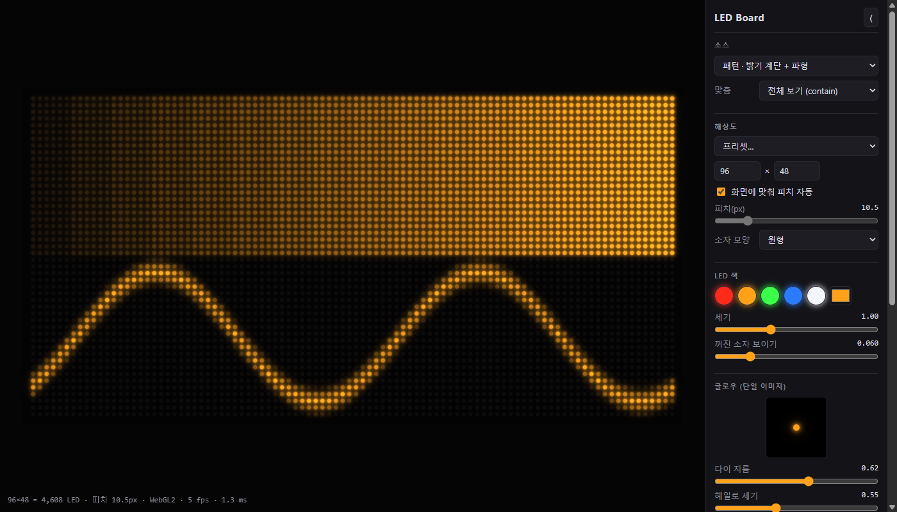

# LED Board Simulator

**English** | [한국어](README.ko.md)

An application that simulates a monochrome LED signboard in a web browser. It shows images, video, a camera feed or text on an LED grid of a given resolution, and draws each LED as an emitter whose glow grows wider as it gets brighter.

All LEDs **share a single glow image and only change its opacity (brightness) per LED**. How this produces the glow expansion is explained in the [design document](docs/design.md).



## Running

There is no build step and no external library.

- **Open directly:** open `index.html` in a browser (Chrome or Edge recommended).
- **Local server:** camera input needs a secure context, so serve it from `localhost`.

  ```bash
  python -m http.server 8000
  # then open http://localhost:8000
  ```

Browsers without WebGL2 fall back to the Canvas2D renderer automatically.

### Desktop app (Electron)

Runs the same web code in an Electron window. Camera input and WebSocket reception work without a browser or local server.

```bash
npm install
npm start                 # development run
npm run dist              # dist/LEDBoard-<version>-portable.exe (single executable, no installer)
```

Browser query parameters are given as command-line arguments. The keys are the same as in the query table below.

```bash
LEDBoard-1.0.0-portable.exe --ws=ws://127.0.0.1:8765/ --panel=0 --cols=96 --rows=48
npm start -- --ws=ws://127.0.0.1:8765/ --panel=0
```

Save PNG and settings export / import / reset move to the menu bar, and the matching panel buttons are hidden in the app. In the browser the panel buttons stay.

| Menu | Items (shortcut) |
|---|---|
| File | Save PNG (`Ctrl+S`), Export Settings (`Ctrl+E`), Import Settings (`Ctrl+O`), Reset Settings, Exit |
| View | Toggle Settings Panel (`H`), Toggle Status Bar (`S`), Full Screen (`F11`), Language (한국어 · English), Reload (`Ctrl+R`, `F5`), Developer Tools (`F12`) |

Regenerate the icon with `python build/gen_icon.py` (requires Pillow). It updates `build/icon.ico` and `electron/icon.png`.

Settings are stored in the app's user data folder (`%APPDATA%\LEDBoard`), separately from the browser.

### Language

The UI supports English and Korean. It starts in the OS / browser language (English unless it is Korean). Change it under **View → Language** in the app or **Misc → Language** in the browser panel; the choice is remembered. The query `lang=en` or the command-line `--lang=en` applies to the current run only and is not saved.

### Sending over WebSocket from an external program

The simulator connects as a WebSocket client and the sending program acts as the server. Test senders are included.

```bash
pip install -r tools/requirements.txt   # websockets, opencv-python
python tools/ws_sender.py led                          # direct LED input (board resolution as is)
python tools/ws_sender.py image ./photos --interval 2  # JPEG, PNG, WebP images
python tools/ws_sender.py raw --size 320x180           # uncompressed pixels

# test bed that sends a laptop webcam (port 8766)
python tools/webcam_sender.py
```

In the simulator, choose **External stream · WebSocket** as the source, enter the address (`ws://127.0.0.1:8765/`) and press [Connect]. Giving the address as a query connects right away. Put the **full address** in the browser address bar. If you enter only `index.html?...`, the browser treats `index.html` as a domain and fails with `DNS_PROBE_FINISHED_NXDOMAIN`.

```text
# opened as a file (adjust the path to your checkout)
file:///D:/workspace/_Lab/LEDBoard/index.html?ws=ws://127.0.0.1:8765/&panel=0

# opened from a local server (python -m http.server 8000)
http://localhost:8000/index.html?ws=ws://127.0.0.1:8765/&panel=0
```

The protocol (message format, control messages, error codes) is in the [external source input interface specification](docs/source-interface.md).

The test senders in `tools/` print their messages in Korean.

### Query parameters and shortcuts

| Query | Meaning |
|---|---|
| `ws=<URL>`, `token=<string>` | Auto-connect to WebSocket, authentication token |
| `cols=`, `rows=` | Starting resolution. Does not overwrite saved settings |
| `panel=0`, `stats=0` | Collapse the settings panel, hide the status bar |
| `lang=ko`, `lang=en` | UI language. Does not overwrite the saved language choice |

Shortcuts: `F` full screen, `H` collapse / expand panel, `S` show / hide status bar.

## Features

| Category | Items |
|---|---|
| Source | Brightness steps + wave pattern, plasma, clock, text scroll, image / video files (drag and drop), camera, external WebSocket stream (images, raw pixels, direct LED input) |
| Fit | contain (show all), cover (fill), stretch |
| Resolution | Presets from 32 × 16 to 320 × 180 or custom (up to 1024 × 1024). Automatic or manual pitch |
| LED | Round or square. Adjustable die diameter, halo strength and width, sprite radius |
| Color | Red, Amber, Green, Blue, White presets and a color picker. Adjustable intensity and unlit LED visibility |
| Tone | Brightness, contrast, gamma, levels (1, 2, 3, 4, 6, 8 bit), 1-bit threshold, invert |
| Exposure compression | Saturates the core and lifts the tail to emphasize the spread. WebGL only |
| Brightness easing | Acceleration model. Each LED keeps a brightness and velocity and integrates the distance to the target as a force. Adjustable response (Hz) and damping ratio ζ, step response preview |
| Idle LED dimming | Gradually dims LEDs whose brightness stops changing. Adjustable change threshold, hold time, fade time and minimum brightness. Recovers when the LED changes again |
| Renderer | WebGL2 instancing, Canvas2D (`drawImage` per LED) |
| Settings | Auto-saved (`localStorage`). Export / import as a JSON file (unknown keys and invalid values are skipped). Reset |
| Misc | Save PNG, collapsible panel, fps display, camera device selection, English and Korean UI |

## Tips

- For a stronger spread, raise halo strength to 0.8–1.0 and halo width to about 0.6, or set exposure compression to 3–6.
- A classic signboard look is 1-bit levels with text scroll.
- With a damping ratio below 0.3, brightness overshoots the target and wobbles before settling. At 1 or above it follows smoothly without overshoot.
- Lower the resolution (e.g. 24 × 10) and use the brightness steps pattern to compare the glow at each brightness.

## Folder structure

```text
LEDBoard/
├── index.html            UI markup
├── css/style.css         styles
├── js/                   global scripts so the page opens from file:// without a build. index.html loads them in dependency order
│   ├── i18n.js           UI string dictionaries (Korean, English) and language switching (I18n)
│   ├── frame.js          renderer input frame formats rgba, luma8, bright (LedFrame)
│   ├── glow-sprite.js    single glow image generation (GlowSprite)
│   ├── tone.js           luminance → brightness LUT (LedTone)
│   ├── led-dynamics.js   per-LED brightness easing, acceleration model (BrightnessDynamics)
│   ├── idle-dimmer.js    idle LED dimming (IdleDimmer)
│   ├── pipeline.js       CPU brightness pipeline: tone → dimming → easing (BrightnessPipeline)
│   ├── source.js         samples the input at LED resolution (FrameSource)
│   ├── renderer-gl.js    WebGL2 instancing renderer (GLRenderer)
│   ├── renderer-2d.js    Canvas2D renderer (Canvas2DRenderer)
│   ├── ws-channel.js     WebSocket external input receiver (WsChannel)
│   ├── settings.js       settings read / save / restore, query parameters (Settings)
│   ├── previews.js       panel previews for glow, easing and dimming (LedPreviews)
│   ├── conn-panel.js     connection panel, status display, display mode UI (ConnPanel)
│   └── main.js           module wiring, UI binding, layout, render loop
├── electron/
│   ├── main.js           desktop app shell: window, menu bar, permissions, command-line arguments
│   ├── preload.js        page → main process channel (UI language)
│   └── icon.png          window icon (generated by build/gen_icon.py)
├── build/                exe icon (icon.ico) and the icon generator script
├── tools/
│   ├── requirements.txt  Python dependencies of the senders
│   ├── ledboard_proto.py shared ledboard.v1 sender module (header, messages, LED bit packing)
│   ├── test_ledboard_proto.py  unit tests for the module above
│   ├── ws_sender.py      WebSocket test sender
│   └── webcam_sender.py  webcam → WebSocket test bed
└── docs/                 each document in English (*.md) and Korean (*.ko.md)
    ├── design.md         design document
    ├── design/           design document resources (figures, figure scripts), shared by both languages
    ├── source-interface.md  external source input interface specification
    └── webcam-testbed.md    webcam test bed usage and processing
```

## Documents

| Document | Contents |
|---|---|
| [Design document](docs/design.md) | Glow rendering principle, architecture, renderer structure, limitations |
| [External source input interface specification](docs/source-interface.md) | Integration spec for external video / image streams (WebRTC, WebSocket) and direct LED input, related UX changes. WebSocket implemented, WebRTC not yet |
| [Webcam test bed](docs/webcam-testbed.md) | Test bed that sends a laptop webcam over WebSocket for display. How to run, send / receive processing, measurements, troubleshooting |

## Known limitations

- Image / video file and camera input have not been verified directly yet.
- Performance on real GPUs has not been measured yet.
- Only WebSocket external input is implemented. WebRTC (WHEP) and screen capture exist only as a spec.
- Video plays muted because of autoplay policies.

For details and future directions (HDR, bloom, 3D depth, WebGPU), see the [design document](docs/design.md).
