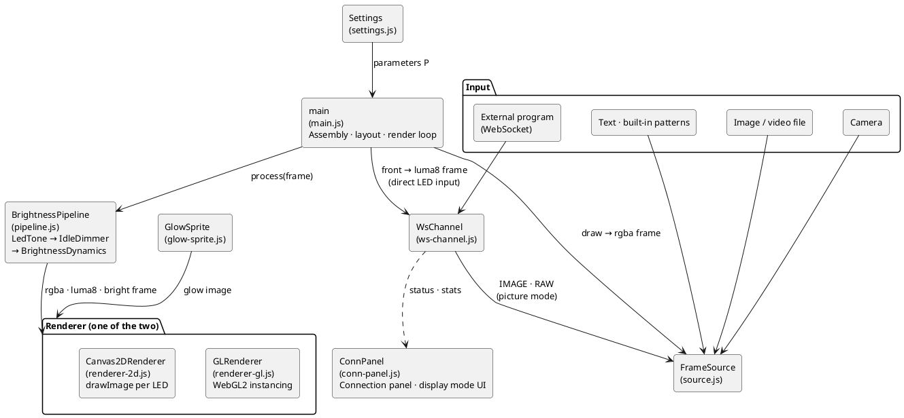
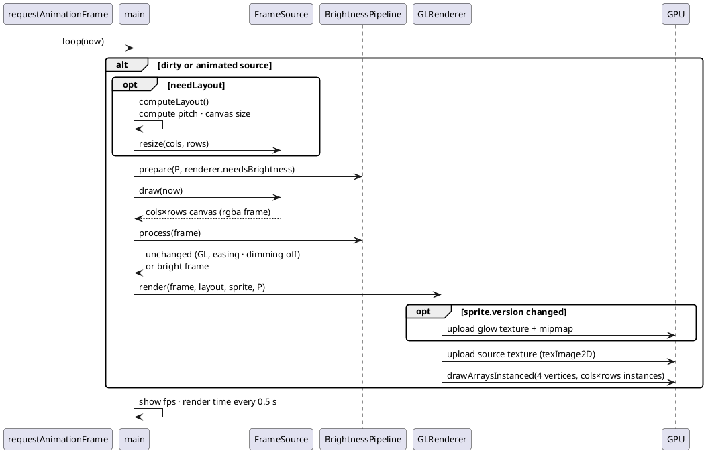
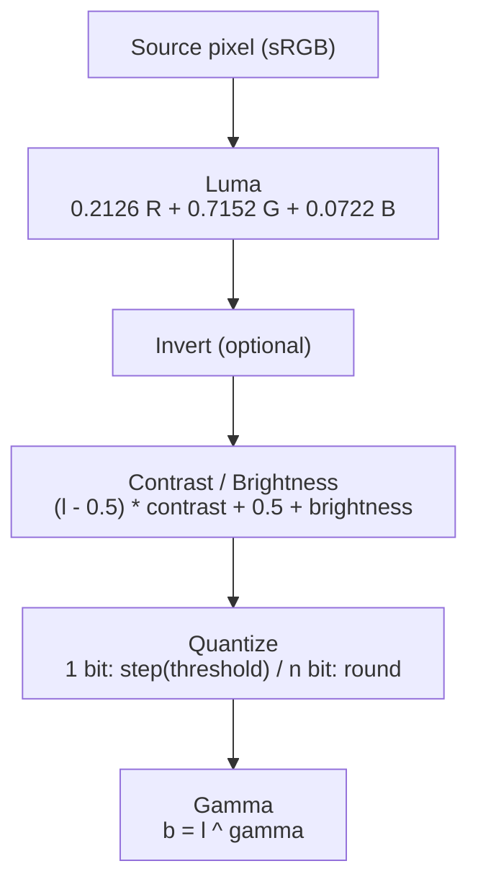

# LED Board Simulator Design Document

**English** | [한국어](design.ko.md)

- Date: 2026-11-17
- Status: PoC complete
- Code covered: `index.html`, `css/style.css`, `js/*.js`

## 1. Purpose and Scope

Realistically simulate a monochrome LED signboard in a web browser. Input images and video are shown on an LED grid of a given resolution (`cols × rows`), and each LED is drawn as an emitter whose glow widens with brightness.

The PoC set out to verify a single hypothesis:

> **With just one glow image prepared up front, drawing it per LED with only its opacity (alpha) changed is enough to show "the brighter, the wider the glow".**

The hypothesis holds (rationale in Section 3, screenshots in Section 11).

| Category | Details |
|---|---|
| In scope | Single monochrome LED type, flat 2D grid, image/video/camera/text/built-in pattern input, WebGL2 and Canvas2D renderers |
| Out of scope | Full-color RGB LEDs, 3D placement and depth, real hardware output, recording. External stream input is defined in a separate spec ([External Source Input Interface Specification](source-interface.md)) |
| Runtime | Recent Chromium-based browsers. No build step, no external libraries |

## 2. Design Principles

| Principle | Application |
|---|---|
| Glow shares a single image | All LEDs share one `GlowSprite`. The only per-LED state is a brightness value (Flyweight) |
| Brightness expressed by multiplication only | Sprite size and shape never change per LED. `glow × b` is additively blended |
| LEDs are not JS objects | GPU instancing used to handle 30,000+ LEDs in real time. LED state is a single texel of the source texture |
| Runs without a build | Classic scripts instead of ES modules, so it runs directly from `file://` |
| Same principle in two renderers | The Canvas2D renderer is a direct port of the principle, serving as a reference and as the fallback when WebGL2 is unavailable |

## 3. Core Principle: Expressing Glow Spread with Opacity Alone

### 3.1 Single Glow Image

`GlowSprite` builds one 256×256 RGBA8 image. One side of the sprite covers `2 × spread` pitches (6 pitches by default).

| Channel | Contents | Purpose |
|---|---|---|
| R | Glow profile P(r). Die core + halo | Light of lit LEDs |
| G | Die mask | Shows unlit LEDs as dark dots |
| B, A | Unused (B = 0, A = 255) | A fixed at 255 to avoid premultiplied alpha issues |

Profile formula (`profile()` in `js/glow-sprite.js`):

```text
rc       = core / 2                                  die radius
die      = 1 - smoothstep(rc - 0.04, rc + 0.04, r)    die edge (with anti-aliasing)
coreLum  = die × (0.85 + 0.15 × (1 - min(1, r / rc)))  inside the die, center slightly brighter
d        = max(0, r - 0.6 × rc)
halo     = H × (0.55 × exp(-d² / (0.7 w²)) + 0.45 × exp(-d / w))
win      = (1 - (r / spread)²)²                         goes to 0 at the sprite edge
P(r)     = min(1, (coreLum + halo) × win)
```

The halo is the sum of two terms. The Gaussian term produces the soft bleed just outside the die, and the exponential term produces the long tail that reaches far out. It is the exponential term that creates the spread effect.

Square LEDs use `0.9 × max(|dx|, |dy|) + 0.1 × r` instead of `r`, producing a square die with slightly rounded corners.

### 3.2 Why the Spread Is Visible

The value drawn on screen is `b × P(r)`. If t is the threshold below which the human eye or an 8-bit display cannot distinguish light, the visible edge of the light is the point where `b × P(r*) = t`.

If the halo tail is `P(r) ≈ A·exp(-r/w)`, the edge is:

```text
r* = w × ln(A × b / t)
```

So even though the sprite size stays the same, **the visible radius grows in proportion to the logarithm of brightness.** The glare you see when looking at a real LED with a camera or the eye widens in the same way.


The visible radius computed with the default parameters (`core 0.62`, `halo 0.55`, `haloWidth 0.4`, `spread 3`) is shown below. The die radius is 0.31 pitch.

| Brightness b | Visible radius (t = 0.02) | Visible radius (t = 1/255) |
|---|---|---|
| 1.0 | 1.08 pitch | 1.58 pitch |
| 0.5 | 0.88 pitch | 1.38 pitch |
| 0.25 | 0.72 pitch | 1.16 pitch |
| 0.1 | 0.53 pitch | 0.88 pitch |

The table and figure were generated with `design/gen_profile_svg.py`. Re-run the script when the parameters change.

Since neighboring LEDs are 1 pitch apart, halos start to overlap their neighbors from around b = 1. With additive blending the overlaps get brighter, and the whole bright area bleeds into a single mass of light.

### 3.3 Exposure Compression (Optional)

With pure alpha the spread is logarithmic and therefore subtle. For cases that need a more exaggerated bleed, the WebGL renderer provides one non-linear option.

```text
a  = P(r) × b
a' = (1 - exp(-k·a)) / (1 - exp(-k))      k = exposure compression (a' = a when 0)
```

Since `a' (1) = 1`, peak brightness is unchanged. The core saturates first and the tail is lifted, so the visible radius grows. It resembles an overexposed camera shot of an LED. This is a per-pixel non-linear operation, so the Canvas2D renderer does not support it.

## 4. Architecture



| Module | Responsibility | Main interface |
|---|---|---|
| `LedFrame` | Defines the frame formats passed from source → pipeline → renderer (`rgba`, `luma8`, `bright`) | `rgba(canvas)`, `luma8()`, `bright()` |
| `GlowSprite` | Builds the single glow image. Redraws and increments `version` when parameters change | `update(opt)`, `canvas`, `version`, `tinted(rgb)` |
| `FrameSource` | Samples input into a `cols × rows` canvas. Handles fit mode | `resize()`, `draw(now)`, `loadFile()`, `useCamera()`, `usePattern()`, `useText()`, `useStream()`, `animated` |
| `LedTone` | Luma → brightness b LUT (same computation as GL `tone()`). Computes per-LED target brightness from a frame. The only implementation of CPU tone processing | `makeLut(params)`, `computeTargets()` |
| `IdleDimmer` | Idle LED dimming. Lowers the brightness of unchanging LEDs toward the minimum brightness over time | `update(base, now, params)`, `active`, `dimmed`, `time95()` |
| `BrightnessDynamics` | LED brightness easing (acceleration model). Takes target brightness and integrates with the exact solution every frame | `setTargetArray()`, `step(dt, f, ζ)`, `display`, `active`, `stepResponse()` |
| `BrightnessPipeline` | Decides and runs the CPU brightness path. Produces a `bright` frame through tone processing → dimming → easing. Passes the input frame through unchanged when not needed | `prepare(params, forceCpu)`, `process(frame, …)`, `moving(params)` |
| `GLRenderer` | WebGL2 instanced rendering. Handles all three frame formats. Tone processing for `rgba`·`luma8` done in the shader | `render(frame, layout, sprite, params)`, `needsBrightness = false` |
| `Canvas2DRenderer` | Draws the same result with Canvas2D. Accepts only `bright` frames | `render(frame, layout, sprite, params)`, `needsBrightness = true` |
| `WsChannel` | Receives external WebSocket input (ledboard.v1). IMAGE·RAW go to `FrameSource`, direct LED input goes to the `front` buffer. Reconnection, stats, error replies | `connect()`, `disconnect()`, `boardChanged()`, `setLedTone()`, `mode`, `front` |
| `ConnPanel` | Connection panel (URL·token·connect·LED tone), status text and badges, disabling controls according to display mode | `bind()`, `connect()`, `update()`, `applyMode()`, `directMode` |
| `Settings` | Reads, saves and restores panel control values. Manages query parameter overrides | `load()`, `save()`, `read()`, `release(id)`, `restoreDefaults()` |
| `LedPreviews` | Glow, easing and dimming previews in the settings panel | `drawAll(sprite, params)` |
| `main` | Module assembly, control event binding, layout computation, render loop, status bar, shortcuts | — |

Settings keys are the same as the panel control ids. The DOM holds the source of truth for values, and `Settings.read()` builds the parameter object `P` used for rendering.

Both renderers share the same `render(frame, layout, sprite, params)` signature. Each renderer has its own canvas, because a single canvas cannot switch between WebGL and 2D contexts. A renderer is created the first time it is selected.

Scripts are kept as global scripts (IIFE) rather than ES modules and loaded from `index.html` in dependency order. ES modules are blocked by CORS on pages opened via `file://`, which would break the usage model of opening `index.html` directly without a build or server.

## 5. Frame Processing Flow



A still image has `animated = false`, so it is redrawn only when settings change (`dirty`). Patterns, text, video and camera are drawn every frame.

While displaying direct LED input, the `WsChannel.front` buffer is used as a `luma8` frame instead of `FrameSource`.

`BrightnessPipeline` performs tone processing on the CPU and produces a `bright` frame when brightness easing or idle LED dimming is on, or when the renderer accepts only `bright` frames (Canvas2D). Otherwise it passes the input frame through unchanged and the GL shader does the tone processing.

When brightness easing or idle LED dimming is on, frame processing splits in two. On frames where the source changed, the source is redrawn, the target brightness is updated, and then dimming and easing advance. On frames where the source is unchanged but brightness is still moving or dimming is in progress, the source is skipped and only dimming and easing advance before drawing (Sections 7.1 and 7.2).

## 6. Input Sampling (FrameSource)

- The internal canvas size is the LED resolution. One pixel corresponds to one LED.
- Downscaling uses `drawImage` with `imageSmoothingQuality = 'high'`. Downscale filter quality depends on the browser implementation (Section 10).
- The canvas is created with `willReadFrequently: true`, because on the CPU brightness path (Canvas2D renderer, easing, dimming) `LedTone.computeTargets()` calls `getImageData` every frame.

| Input | Handling |
|---|---|
| Image | `URL.createObjectURL` → `Image`. Still source |
| Video | `<video muted loop playsInline>`. Looped playback without sound |
| Camera | `getUserMedia({ video: true })`. Horizontally flipped (mirror mode) |
| Text | Font size = `rows × 0.82`. Scrolls right to left. Speed in LEDs/s |
| Pattern | Brightness steps + sine wave (for checking glow spread), plasma, clock |

There are three fit modes: `contain` (show all, remaining area black), `cover` (fill, overflow cropped) and `stretch` (aspect ratio ignored).

When the source changes, `_release()` revokes the previous object URL and stops the camera tracks.

## 7. Tone Pipeline

This is the process of deriving LED brightness b from a source pixel. In GL, `tone()` in the vertex shader does it; on the CPU path (Canvas2D, brightness easing, dimming), the 256-entry LUT of `LedTone` (js/tone.js), called through `BrightnessPipeline`, performs the same computation. `LedTone` is the only CPU-side implementation.



- Luma multiplies the sRGB-encoded values directly by the Rec.709 coefficients. No conversion to linear light.
- The default gamma is 1.02, effectively 1.0. The framebuffer is also in sRGB-encoded space, so using the source value directly as alpha makes the perceived brightness match the source.
- At 2 levels (1 bit), On/Off is split by the threshold; at 4–64 levels, uniform quantization is applied. At 256, no quantization.

### 7.1 Brightness Easing (Acceleration Model)

The b obtained from tone processing is the **target brightness**. With easing on, an LED does not jump to the target; it moves like a body with brightness x and velocity v. Rather than an ordinary time → progress easing curve, it is an acceleration model that uses the distance to the target as a force (`js/led-dynamics.js`).

```text
a = k·(b − x) − c·v        force = distance to target × stiffness,  friction = velocity × damping
dv/dt = a,   dx/dt = v

k = (2π·f)²                f = response speed (Hz, natural frequency)
c = 2·ζ·√k                 ζ = damping ratio
```

Without the damping term `−c·v`, it would overshoot the target and oscillate forever. Users are given the intuitive f and ζ instead of k and c.

| ζ | Motion |
|---|---|
| < 1 (underdamped) | Overshoots the target and comes back. Overshoot = `exp(−ζπ/√(1−ζ²))`. E.g. 9.5% at ζ = 0.6 |
| = 1 (critically damped) | Fastest arrival without overshoot |
| > 1 (overdamped) | Slow approach without overshoot |

**Integration.** Plain Euler (`v += a·dt; x += v·dt`) gives results that depend on the frame interval and diverges when f or ζ is large. Since this equation is linear while the target is fixed during a frame, we set `e = x − b` and use the state transition matrix.

```text
[e', v'] = M(dt)·[e, v],    M(dt) = exp([[0, 1], [−k, −c]]·dt)
```

M is computed once per frame from the closed-form solution for the under-, critically or overdamped case depending on ζ. Each LED gets its next state with 4 multiplications, exactly, regardless of the frame interval. A single frame interval is clamped to at most 0.25 s, so that long gaps such as tab switches do not cause a sudden jump.

**Where it applies and how it is displayed.**

- Applied to the final brightness **after** tone processing (invert, contrast, levels, gamma). A 1-bit On/Off display also changes smoothly when turning on and off. Changing tone settings changes the target, so the LED eases to the new brightness.
- The internal state x·v is not clamped; it is clamped to [0, 1] only for display. Overshoot appears clipped at 1, but the physical motion continues.
- Once every LED settles within 1×10⁻⁴ of its target, easing goes idle and the render loop rests too.
- When easing is turned back on or the resolution changes, it starts from the current target (prevents flicker).

**Where it is computed.** Computed on the CPU with `Float32Array`, and the result is uploaded as an R32F texture. The shader uses this value as is, without tone processing (`uInput.x = 2`). CPU time per frame (target computation + integration, measured in headless Chrome) is shown below.

| Board | LEDs | Time |
|---|---|---|
| 96 × 48 | 4,608 | about 0.14 ms |
| 320 × 180 | 57,600 | about 2.3 ms |
| 640 × 360 | 230,400 | about 5.4 ms |

If larger boards are needed, move to a GPU approach (ping-pong) that keeps the state in two RG32F textures and updates it with a shader. The transition matrix computation can be reused as is.

**Verification.** The step response matched the analytical solution within a maximum difference of 6×10⁻⁸ (f = 0.5–20 Hz, ζ = 0.05–2). Advancing 0.25 s in one step and advancing 1/240 s sixty times gave the same result to the sixth decimal place.

### 7.2 Idle LED Dimming

A mode that gradually dims LEDs whose brightness does not change beyond a certain amount (`js/idle-dimmer.js`, off by default). Used to draw the eye toward moving parts when a still screen stays up for a long time, or to mimic the burn-in prevention and power saving of real signage.

```text
Change test:   |b − ref| > change threshold  →  ref = b,  last = now
Dim factor:    idle = now − last − hold time
               g = 1                                        (idle ≤ 0)
                 = floor + (1 − floor)·exp(−idle / τ)       (idle > 0)
Output:        b × g
```

| Parameter | Default | Meaning |
|---|---|---|
| Change threshold | 0.04 | Brightness (0–1) must change by more than this to count as a change. Filters out video noise |
| Hold time | 0 s | Wait after changes stop before dimming starts |
| Fade time τ | 2.9 s | Exponential decay time constant. The remaining difference drops to about 37% every τ |
| Minimum brightness | 0.17 | Lower limit of dimming. Fraction of the original brightness |

- The reference brightness ref is updated only when a change is detected. Small jitter is therefore ignored, but small changes that accumulate past the threshold do count as a change.
- The test uses the brightness b before dimming, so the LED's own dimming is not mistaken for a change.
- g is computed directly from elapsed time, so it is independent of fps. The time to get 95% of the way to the minimum brightness is `hold time + τ·ln 20 ≈ hold time + 3τ`.
- When the LED changes again, g returns to 1 immediately. If brightness easing is on, the dimming result becomes the easing target, so both recovery and dimming move smoothly under the acceleration model.
- While any lit LED is holding or dimming, the render loop keeps running. Once all reach the minimum, it rests again.

The processing order is `tone processing → dimming → easing → renderer`, and `BrightnessPipeline` (js/pipeline.js) calls them in this order. If either easing or dimming is on, the CPU brightness path (the R32F upload from Section 7.1) is used.

**Verification.** In unit tests the dimming value matched the formula (0.3449 at t = 5 s). Noise of 0.03 was ignored, while an accumulated 0.07 and a large change caused a reset. On a still image (hold 1 s, τ 1 s, minimum 0.1) the screen brightness was 0.676 at 1.45 s, 0.416 at 2.04 s, 0.229 at 2.94 s and 0.129 at 4.43 s, matching the theoretical values (0.674, 0.418, 0.229, 0.129). The render loop stopped after all LEDs reached the minimum, and when a change was applied the original brightness returned within 0.7 s. When the amount of change is exactly equal to the threshold, float rounding may cause it to be detected as a change.

## 8. Renderers

### 8.1 GLRenderer (WebGL2)

**Draw call setup**

- The vertex buffer holds only the 4 corners of a unit quad (`-1..1`). There are no per-LED attributes.
- A single `drawArraysInstanced(TRIANGLE_STRIP, 0, 4, cols × rows)` draws the whole screen.
- The vertex shader derives column and row from `gl_InstanceID` and reads its own pixel from the source texture with `texelFetch`.

**Textures**

| Texture | Format | Filter | Update |
|---|---|---|---|
| Source | RGBA8, `cols × rows` | NEAREST | `texImage2D(canvas)` every frame |
| Direct LED input | R8, `cols × rows` | NEAREST | When displaying WebSocket LED frames |
| Final brightness | R32F, `cols × rows` | NEAREST (float not filterable) | Every frame when brightness easing or dimming is in use. Shader skips tone processing |
| Glow | RGBA8, 256 × 256 | LINEAR_MIPMAP_LINEAR | Only when `sprite.version` changes |

The glow texture uses mipmaps to prevent aliasing when the pitch is small (when the sprite is shrunk to a few tens of px).

**Compositing**

```glsl
a   = glow.r * b                     // single image × brightness
col = ledColor * a * intensity + offColor * glow.g * (1 - b)
```

- Blending is additive, `blendFunc(ONE, ONE)`. The result is order-independent, so no sorting is needed.
- The unlit LED color `offColor` mixes gray and the LED color 65:35 and then multiplies by `offLevel`. It fades out by `(1 - b)` as the LED lights up.

**Saving fill-rate**

| LED state | Quad size |
|---|---|
| Lit (b > 0.002) | Full sprite (radius `spread` pitches) |
| Unlit, Unlit LED visibility on | Die size (radius `min(spread, 0.6 × core)` pitches). UV shrunk accordingly to read the same texture region |
| Unlit, Unlit LED visibility off | Sent as a degenerate quad outside clip space, skipping rasterization |

### 8.2 Canvas2DRenderer

The most direct port of the idea.

1. The background and unlit LED dots are drawn once to a separate canvas and cached. Redrawn only when the layout, sprite or color changes.
2. It receives a `bright` frame (final brightness b). Tone processing is done in advance by `BrightnessPipeline` using `LedTone` (`needsBrightness = true`).
3. With `globalCompositeOperation = 'lighter'`, a tinted sprite is drawn with `drawImage` for each lit LED with `globalAlpha = b`.

The tinted sprite is an image with RGB filled with the LED color and the glow profile (R channel) in the alpha channel. It is rebuilt only when the color or sprite changes.

When `intensity > 1`, `globalAlpha` cannot exceed 1, so the same image is drawn several times on top of itself.

Differences from the GL renderer:

| Item | GLRenderer | Canvas2DRenderer |
|---|---|---|
| Where processed | GPU shader | CPU loop + browser 2D compositing |
| Cost | LED count × sprite area (GPU fill-rate) | One `drawImage` call per lit LED |
| Exposure compression | Supported | Not supported |
| Die of a lit LED | Unlit color fades out by `(1 - b)` | Light added on top of the unlit color (negligible difference) |

## 9. Layout and Coordinate System

- A 1-pitch margin is left around the board, so the glow of edge LEDs is not clipped.
- The canvas CSS size is `(cols + 2) × pitch` × `(rows + 2) × pitch`, and the actual pixel size is that multiplied by `devicePixelRatio`.
- The center of LED (c, r) is `origin + (c + 0.5, r + 0.5) × pitch` (device px).
- In auto pitch mode, `min((W - 24) / (cols + 2), (H - 24) / (rows + 2))` is rounded down to 0.5 px steps. W and H are the CSS size of the stage area.
- The layout is recomputed when the window size or panel collapse state changes.

## 10. Limitations

| Item | Details | Impact |
|---|---|---|
| Sprite precision | Glow texture is 8 bit | Strong exposure compression may cause banding in the halo tail |
| Additive saturation | Framebuffer clips at 1.0 | Color shifts toward yellow/white in overlapping areas. Similar to real overexposure, so accepted for the PoC |
| Gamma handling | Compositing in sRGB space, not linear light | Overlap brightness not physically accurate |
| Downscale filter | Depends on the browser's `drawImage` downscale quality | Aliasing possible when shrinking large video to a very small resolution |
| Camera | `getUserMedia` requires a secure context | May be blocked on `file://` depending on the browser. Serving via `localhost` recommended |
| Video sound | Always muted due to autoplay policy | No sound playback |
| Settings storage | Only slider values stored in `localStorage` (`ledboard.settings.v1`) | Source type and opened file not saved |

## 11. Verification Results

Checked in headless Chrome (SwiftShader WebGL).

| Item | Result |
|---|---|
| WebGL2 shader compilation | Failed on first run because the variable name `half` is a GLSL reserved word. Fixed by renaming to `hs`. No console errors since |
| 96 × 48 default screen | Brightness steps and waveform displayed correctly |
| 24 × 10 zoomed screen | Confirmed brighter LEDs have wider halos. Dim LEDs show only the die |
| GL vs. Canvas2D | Nearly identical output with the same settings |
| Image/video files, camera | Not verified |
| Performance | Not measured. fps figures in a headless SwiftShader environment are meaningless |

96 × 48, WebGL2:


24 × 10, WebGL2 on the left / Canvas2D on the right:

| WebGL2 | Canvas2D |
|---|---|
|  |  |

## 12. Future Extensions

| Item | Direction |
|---|---|
| Performance measurement | Measure fps on a real GPU by resolution, pitch and sprite radius. Bottleneck expected to be `LED count × sprite area` (overdraw) rather than LED count |
| HDR accumulation | Accumulate into a float render target (`EXT_color_buffer_float`), then tone mapping. Mitigates color shifts on saturation |
| Screen-space bloom | Draw only the LED cores and handle bleed with a downscaled-buffer blur. Cost becomes nearly independent of LED count |
| 3D placement and depth | Add z and a view-projection matrix to the vertex shader, billboard quads, layered textures (`TEXTURE_2D_ARRAY`/3D textures). Additive blending, so no depth sorting needed. Add distance attenuation, DOF (choosing blurred sprites), occlusion by an opaque PCB |
| WebGPU | Culling and LOD with compute shaders at hundreds of thousands of LEDs and beyond |
| Downscale quality | Improve sampling quality with stepwise downscaling or an area-average shader |
| External source input | WebSocket reception (image, raw pixels, direct LED input) and related UX implemented. Remaining: WebRTC (WHEP) video reception and screen capture. Spec: [External Source Input Interface Specification](source-interface.md) |
| Output | Recording with `MediaRecorder`, sending pixel data to a real LED controller |
