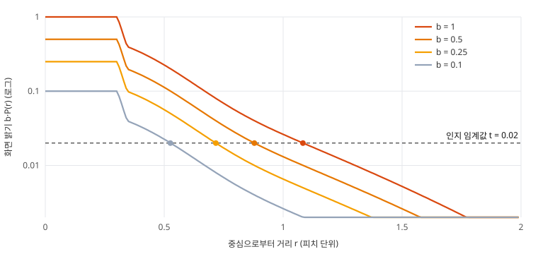
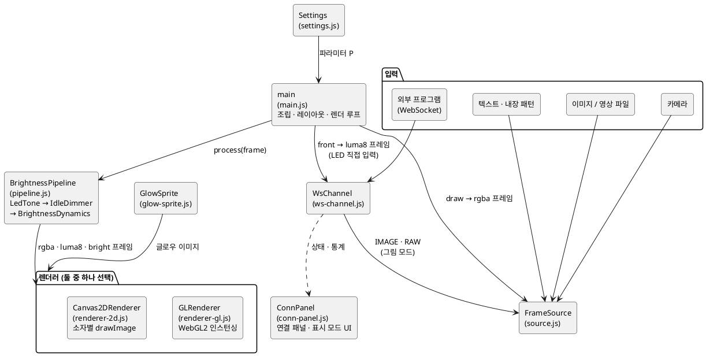
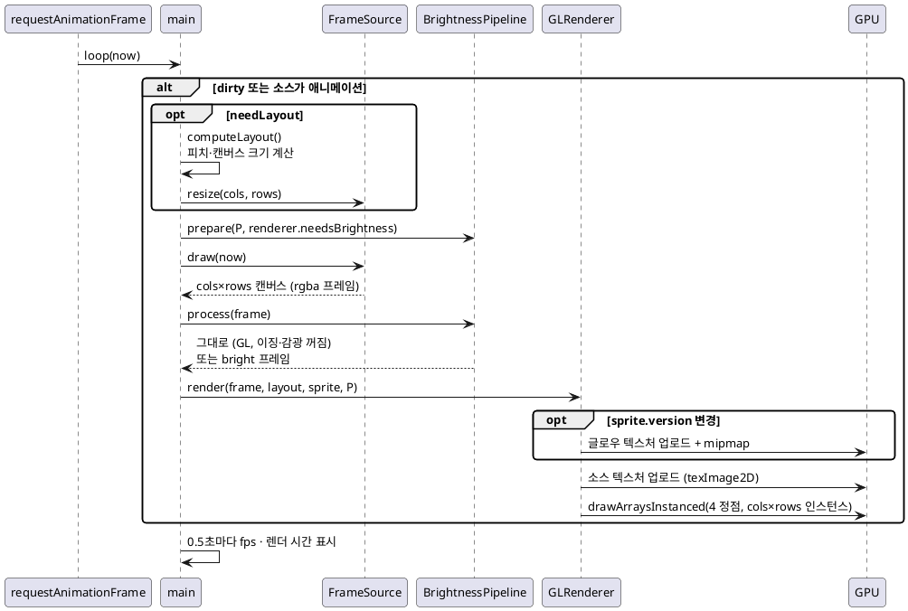
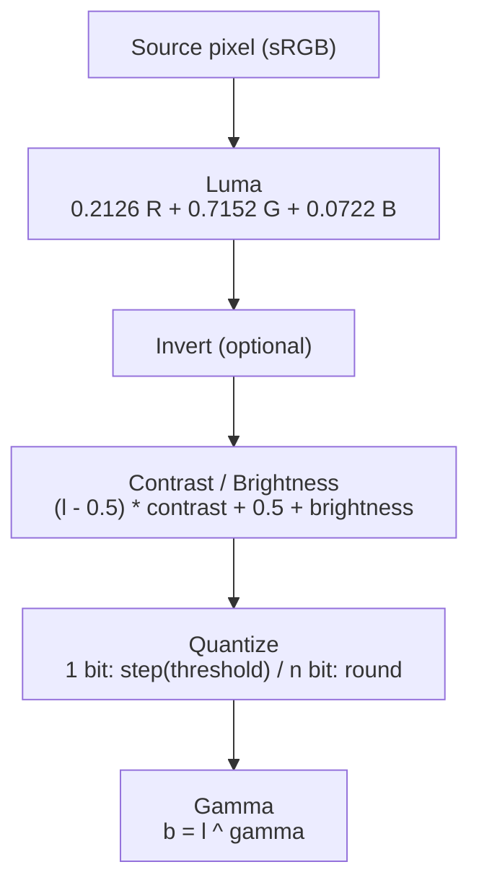
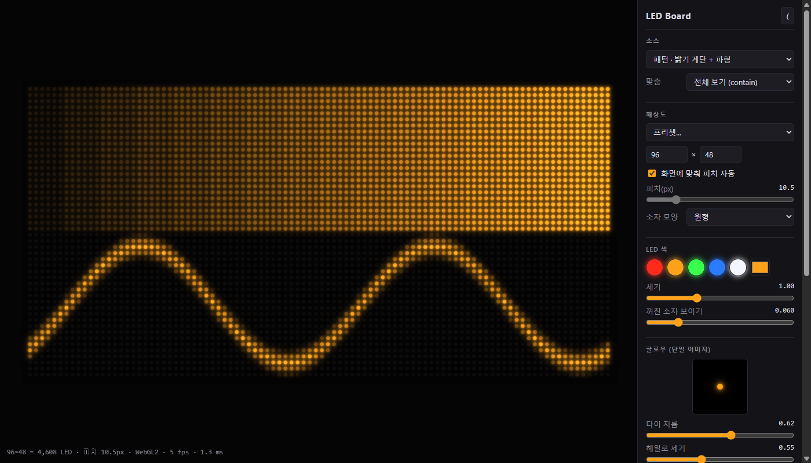
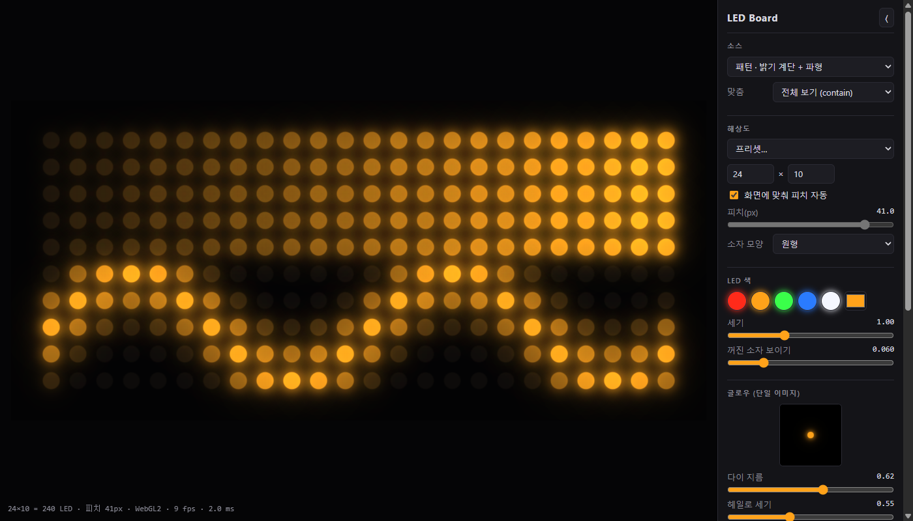
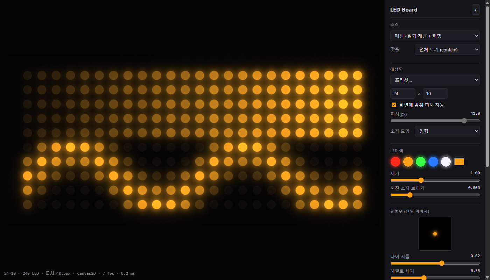

# LED Board Simulator 설계 문서

- 작성일: 2026-11-17
- 상태: PoC 완료
- 대상 코드: `index.html`, `css/style.css`, `js/*.js`

## 1. 목적과 범위

단색 LED 전광판을 웹 브라우저에서 사실적으로 모사한다. 입력 이미지·영상을 지정한 해상도(`cols × rows`)의 LED 격자로 표시하고, 각 소자는 밝기에 따라 글로우가 넓어지는 발광체로 그린다.

PoC에서 검증하려던 가설은 다음 하나다.

> **글로우 이미지 하나만 만들어 두고, 소자마다 투명도(알파)만 바꿔 그려도 "밝을수록 글로우가 넓어지는" 모습을 표현할 수 있다.**

검증 결과 가설은 성립한다(근거는 3절, 확인 화면은 11절).

| 구분 | 내용 |
|---|---|
| 범위 | 단색 LED 1종, 2D 평면 격자, 이미지·영상·카메라·텍스트·내장 패턴 입력, WebGL2와 Canvas2D 렌더러 |
| 범위 밖 | 풀컬러 RGB LED, 3D 배치·깊이 표현, 실제 하드웨어 출력, 녹화. 외부 스트림 입력은 별도 사양으로 정의 ([외부 소스 입력 인터페이스 사양](source-interface.md)) |
| 실행 환경 | 최신 Chromium 계열 브라우저. 빌드 단계와 외부 라이브러리 없음 |

## 2. 설계 원칙

| 원칙 | 적용 |
|---|---|
| 글로우는 이미지 하나만 공유 | 모든 소자가 `GlowSprite` 하나를 공유. 소자별 상태는 밝기 값 하나뿐 (Flyweight) |
| 밝기는 곱셈으로만 표현 | 스프라이트 크기·모양을 소자별로 바꾸지 않음. `glow × b`를 가산 합성 |
| 소자를 JS 객체로 만들지 않음 | 3만 개 이상의 소자도 실시간 처리하기 위해 GPU 인스턴싱 사용. 소자 상태는 소스 텍스처의 텍셀 1개 |
| 빌드 없이 실행 | ES module 대신 classic script를 써서 `file://`에서도 바로 실행 |
| 같은 원리를 두 렌더러로 구현 | Canvas2D 렌더러는 원리를 그대로 옮긴 비교 기준이자 WebGL2가 없을 때의 fallback |

## 3. 핵심 원리: 투명도만으로 글로우 확장 표현

### 3.1 단일 글로우 이미지

`GlowSprite`가 256×256 RGBA8 이미지를 한 번 만든다. 스프라이트 한 변은 `2 × spread` 피치(기본 6 피치)를 덮는다.

| 채널 | 내용 | 용도 |
|---|---|---|
| R | 글로우 프로파일 P(r). 다이 코어 + 헤일로 | 켜진 소자의 빛 |
| G | 다이 마스크 | 꺼진 소자를 어두운 점으로 표시 |
| B, A | 미사용 (B = 0, A = 255) | premultiplied alpha 문제를 피하려고 A를 255로 고정 |

프로파일 식(`js/glow-sprite.js`의 `profile()`):

```text
rc       = core / 2                                  다이 반지름
die      = 1 - smoothstep(rc - 0.04, rc + 0.04, r)    다이 경계 (anti-aliasing 포함)
coreLum  = die × (0.85 + 0.15 × (1 - min(1, r / rc)))  다이 안쪽, 중심이 약간 더 밝음
d        = max(0, r - 0.6 × rc)
halo     = H × (0.55 × exp(-d² / (0.7 w²)) + 0.45 × exp(-d / w))
win      = (1 - (r / spread)²)²                         스프라이트 경계에서 0으로
P(r)     = min(1, (coreLum + halo) × win)
```

헤일로는 두 항을 합친 것이다. 가우시안 항은 다이 바로 바깥의 부드러운 번짐을, 지수 항은 멀리까지 이어지는 긴 꼬리를 만든다. 확장 효과를 만드는 것은 지수 항이다.

사각형 소자는 `r` 대신 `0.9 × max(|dx|, |dy|) + 0.1 × r`을 써서 모서리가 살짝 둥근 사각 다이를 만든다.

### 3.2 확장이 보이는 이유

화면에 그려지는 값은 `b × P(r)`이다. 사람 눈이나 8 bit 디스플레이가 구분하지 못하는 임계값을 t라 하면, 빛이 보이는 경계는 `b × P(r*) = t`인 지점이다.

헤일로 꼬리가 `P(r) ≈ A·exp(-r/w)`이면 경계는 다음과 같다.

```text
r* = w × ln(A × b / t)
```

즉 스프라이트 크기는 그대로인데도 **보이는 반경이 밝기의 로그에 비례해 넓어진다.** 카메라나 눈으로 실제 LED를 볼 때 생기는 glare도 같은 형태로 넓어진다.



기본 파라미터(`core 0.62`, `halo 0.55`, `haloWidth 0.4`, `spread 3`)로 계산한 보이는 반경은 아래와 같다. 다이 반지름은 0.31 피치다.

| 밝기 b | 보이는 반경 (t = 0.02) | 보이는 반경 (t = 1/255) |
|---|---|---|
| 1.0 | 1.08 피치 | 1.58 피치 |
| 0.5 | 0.88 피치 | 1.38 피치 |
| 0.25 | 0.72 피치 | 1.16 피치 |
| 0.1 | 0.53 피치 | 0.88 피치 |

표와 그림은 `design/gen_profile_svg.py`로 생성했다. 파라미터를 바꾸면 이 스크립트를 다시 실행한다.

이웃 소자 간격이 1 피치이므로 b = 1 근처부터 헤일로가 이웃과 겹치기 시작한다. 가산 합성이라 겹친 부분이 더 밝아지고, 밝은 영역 전체가 하나의 빛 덩어리로 번지는 모습이 된다.

### 3.3 노출 압축 (선택)

순수 알파 방식에서는 확장이 로그 비례라 은은하다. 더 과장된 번짐이 필요할 때를 위해 WebGL 렌더러에 비선형 옵션을 하나 둔다.

```text
a  = P(r) × b
a' = (1 - exp(-k·a)) / (1 - exp(-k))      k = 노출 압축 (0이면 a' = a)
```

`a' (1) = 1`이므로 최대 밝기는 그대로다. 코어는 먼저 포화되고 꼬리는 들려 올라가서 보이는 반경이 커진다. 카메라로 LED를 과노출 촬영한 느낌에 가깝다. 이 연산은 픽셀 단위 비선형이라 Canvas2D 렌더러에서는 지원하지 않는다.

## 4. 아키텍처



| 모듈 | 책임 | 주요 인터페이스 |
|---|---|---|
| `LedFrame` | 소스 → 파이프라인 → 렌더러로 넘기는 프레임 형식 정의 (`rgba`, `luma8`, `bright`) | `rgba(canvas)`, `luma8()`, `bright()` |
| `GlowSprite` | 단일 글로우 이미지 생성. 파라미터가 바뀌면 다시 그리고 `version` 증가 | `update(opt)`, `canvas`, `version`, `tinted(rgb)` |
| `FrameSource` | 입력을 `cols × rows` 캔버스로 샘플링. 맞춤 방식 처리 | `resize()`, `draw(now)`, `loadFile()`, `useCamera()`, `usePattern()`, `useText()`, `useStream()`, `animated` |
| `LedTone` | 휘도 → 밝기 b 변환 LUT (GL `tone()`과 같은 계산). 프레임에서 소자별 목표 밝기 계산. CPU 톤 처리의 유일한 구현 | `makeLut(params)`, `computeTargets()` |
| `IdleDimmer` | 정지 소자 감광. 변화 없는 소자의 밝기를 시간에 따라 최저 밝기로 내림 | `update(base, now, params)`, `active`, `dimmed`, `time95()` |
| `BrightnessDynamics` | 소자 밝기 이징(가속도 모델). 목표 밝기를 받아 프레임마다 정확한 해로 적분 | `setTargetArray()`, `step(dt, f, ζ)`, `display`, `active`, `stepResponse()` |
| `BrightnessPipeline` | CPU 밝기 경로 결정과 실행. 톤 처리 → 감광 → 이징을 거쳐 `bright` 프레임 생성. 필요 없으면 입력 프레임을 그대로 통과 | `prepare(params, forceCpu)`, `process(frame, …)`, `moving(params)` |
| `GLRenderer` | WebGL2 인스턴싱 렌더링. 세 프레임 형식 모두 처리. `rgba`·`luma8`는 셰이더에서 톤 처리 | `render(frame, layout, sprite, params)`, `needsBrightness = false` |
| `Canvas2DRenderer` | 같은 결과를 Canvas2D로 그림. `bright` 프레임만 받음 | `render(frame, layout, sprite, params)`, `needsBrightness = true` |
| `WsChannel` | 외부 WebSocket 입력 수신(ledboard.v1). IMAGE·RAW는 `FrameSource`로, LED 직접 입력은 `front` 버퍼로 전달. 재연결, 통계, 오류 회신 | `connect()`, `disconnect()`, `boardChanged()`, `setLedTone()`, `mode`, `front` |
| `ConnPanel` | 연결 패널(URL·토큰·연결·LED 톤), 상태 문구·배지, 표시 모드에 따른 컨트롤 비활성화 | `bind()`, `connect()`, `update()`, `applyMode()`, `directMode` |
| `Settings` | 패널 컨트롤 값 읽기·저장·복원. 쿼리 파라미터 덮어쓰기 관리 | `load()`, `save()`, `read()`, `release(id)`, `restoreDefaults()` |
| `LedPreviews` | 설정 패널의 글로우·이징·감광 미리보기 | `drawAll(sprite, params)` |
| `main` | 모듈 조립, 컨트롤 이벤트 바인딩, 레이아웃 계산, 렌더 루프, 상태 표시줄, 단축키 | — |

설정 키는 패널 컨트롤의 id와 같다. 값의 원본은 DOM이고, `Settings.read()`가 렌더링에 쓰는 파라미터 `P`를 만든다.

두 렌더러는 같은 `render(frame, layout, sprite, params)` 시그니처를 가진다. 렌더러마다 캔버스를 따로 두는데, 한 캔버스에서 WebGL과 2D 컨텍스트를 바꿔 가며 쓸 수 없기 때문이다. 렌더러는 처음 선택될 때 생성된다.

스크립트는 ES module이 아닌 전역 스크립트(IIFE)로 두고 `index.html`에서 의존 순서대로 불러온다. ES module은 `file://`로 연 페이지에서 CORS로 막혀, 빌드·서버 없이 `index.html`을 바로 여는 사용 방식을 지킬 수 없기 때문이다.

## 5. 프레임 처리 흐름



정지 이미지는 `animated = false`라 설정이 바뀔 때(`dirty`)만 다시 그린다. 패턴, 텍스트, 영상, 카메라는 매 프레임 그린다.

LED 직접 입력으로 표시 중이면 `FrameSource` 대신 `WsChannel.front` 버퍼를 `luma8` 프레임으로 쓴다.

`BrightnessPipeline`은 밝기 이징이나 정지 소자 감광이 켜져 있거나, 렌더러가 `bright` 프레임만 받을 때(Canvas2D) CPU에서 톤 처리를 하고 `bright` 프레임을 만든다. 그 밖에는 입력 프레임을 그대로 넘기고 GL 셰이더가 톤 처리를 한다.

밝기 이징이나 정지 소자 감광이 켜져 있으면 프레임 처리가 둘로 나뉜다. 소스가 바뀐 프레임은 소스를 다시 그리고 목표 밝기를 갱신한 뒤 감광·이징을 진행한다. 소스는 그대로지만 밝기가 아직 움직이거나 감광이 진행 중인 프레임은 소스를 건너뛰고 감광·이징만 진행해 그린다(7.1절, 7.2절).

## 6. 입력 샘플링 (FrameSource)

- 내부 캔버스 크기가 곧 LED 해상도다. 픽셀 1개가 LED 1개에 대응한다.
- `drawImage`로 축소하며 `imageSmoothingQuality = 'high'`를 준다. 축소 필터 품질은 브라우저 구현에 따른다(10절).
- 캔버스는 `willReadFrequently: true`로 만든다. CPU 밝기 경로(Canvas2D 렌더러, 이징, 감광)에서 `LedTone.computeTargets()`가 매 프레임 `getImageData`를 호출하기 때문이다.

| 입력 | 처리 |
|---|---|
| 이미지 | `URL.createObjectURL` → `Image`. 정지 소스 |
| 영상 | `<video muted loop playsInline>`. 소리 없이 반복 재생 |
| 카메라 | `getUserMedia({ video: true })`. 좌우 반전(거울 모드) |
| 텍스트 | 글꼴 크기 = `rows × 0.82`. 오른쪽에서 왼쪽으로 스크롤. 속도 단위는 LED/초 |
| 패턴 | 밝기 계단 + 사인 파형 (글로우 확장 확인용), 플라즈마, 시계 |

맞춤 방식은 `contain`(전체 보기, 남는 곳은 검정), `cover`(채우기, 넘치는 곳은 잘림), `stretch`(비율 무시) 세 가지다.

소스를 바꿀 때 `_release()`가 이전 object URL을 해제하고 카메라 트랙을 정지한다.

## 7. 톤 파이프라인

원본 픽셀에서 LED 밝기 b를 구하는 과정이다. GL은 버텍스 셰이더의 `tone()`이, CPU 경로(Canvas2D, 밝기 이징, 감광)는 `BrightnessPipeline`을 거쳐 `LedTone`(js/tone.js)의 256단계 LUT가 같은 계산을 한다. CPU 쪽 구현은 `LedTone` 하나뿐이다.



- 휘도는 sRGB 인코딩 값에 Rec.709 계수를 그대로 곱한다. 선형광으로 변환하지 않는다.
- 감마 기본값은 1.02로 사실상 1.0이다. 프레임버퍼도 sRGB 인코딩 공간이라, 원본 값을 그대로 알파로 쓰면 보이는 밝기가 원본과 맞는다.
- 계조 2(1 bit)에서는 임계값으로 On/Off를 나누고, 4~64에서는 균등 양자화한다. 256이면 양자화하지 않는다.

### 7.1 밝기 이징 (가속도 모델)

톤 처리로 구한 b는 **목표 밝기**다. 이징을 켜면 소자는 목표로 바로 바뀌지 않고, 밝기 x와 변화 속도 v를 가진 물체처럼 움직인다. 시간 → 진행률 형태의 일반 이징 곡선이 아니라, 목표까지의 거리를 힘으로 삼는 가속도 모델이다(`js/led-dynamics.js`).

```text
a = k·(b − x) − c·v        힘 = 목표까지 거리 × 강성,  마찰 = 속도 × 감쇠
dv/dt = a,   dx/dt = v

k = (2π·f)²                f = 반응 속도(Hz, 고유 진동수)
c = 2·ζ·√k                 ζ = 감쇠비
```

감쇠항 `−c·v`가 없으면 목표를 지나쳐 영원히 진동한다. 사용자에게는 k·c 대신 직관적인 f와 ζ를 노출한다.

| ζ | 움직임 |
|---|---|
| < 1 (부족 감쇠) | 목표를 지나쳤다 돌아옴. 오버슈트 = `exp(−ζπ/√(1−ζ²))`. 예: ζ = 0.6이면 9.5% |
| = 1 (임계 감쇠) | 지나치지 않고 가장 빨리 도달 |
| > 1 (과감쇠) | 지나치지 않고 느리게 다가감 |

**적분.** 단순 오일러(`v += a·dt; x += v·dt`)는 결과가 프레임 간격에 따라 달라지고, f가 크거나 ζ가 크면 발산한다. 이 식은 한 프레임 동안 목표가 고정이면 선형이므로, `e = x − b`로 두고 상태 전이 행렬을 쓴다.

```text
[e', v'] = M(dt)·[e, v],    M(dt) = exp([[0, 1], [−k, −c]]·dt)
```

M은 ζ에 따라 부족·임계·과감쇠의 닫힌 해로 프레임마다 한 번 계산한다. 소자마다 곱셈 4번으로 다음 상태를 얻으며, 프레임 간격과 무관하게 정확하다. 한 프레임 간격은 최대 0.25초로 자른다. 탭 전환처럼 긴 공백에서 한꺼번에 튀지 않게 하기 위해서다.

**적용 위치와 표시.**

- 톤 처리(반전, 대비, 계조, 감마) **뒤**의 최종 밝기에 적용한다. 1 bit On/Off 화면도 켜지고 꺼질 때 부드럽게 바뀐다. 톤 설정을 바꿔도 목표가 바뀌는 것이라 새 밝기로 이징된다.
- 내부 상태 x·v는 자르지 않고, 표시할 때만 [0, 1]로 자른다. 오버슈트는 1에서 잘려 보이지만 물리적 흐름은 이어진다.
- 모든 소자가 목표의 1×10⁻⁴ 안에서 멈추면 이징을 정지 상태로 두고 렌더 루프도 쉰다.
- 이징을 다시 켜거나 해상도가 바뀌면 현재 목표에서 출발한다(깜빡임 방지).

**계산 위치.** CPU에서 `Float32Array`로 계산하고, 결과를 R32F 텍스처로 올린다. 셰이더는 이 값을 톤 처리 없이 그대로 쓴다(`uInput.x = 2`). 프레임당 CPU 시간(목표 계산 + 적분, 헤드리스 Chrome 측정)은 아래와 같다.

| 보드 | 소자 수 | 시간 |
|---|---|---|
| 96 × 48 | 4,608 | 약 0.14 ms |
| 320 × 180 | 57,600 | 약 2.3 ms |
| 640 × 360 | 230,400 | 약 5.4 ms |

더 큰 보드가 필요하면 상태를 RG32F 텍스처 두 장에 두고 셰이더로 갱신하는 GPU 방식(ping-pong)으로 옮긴다. 전이 행렬 계산은 그대로 쓸 수 있다.

**검증.** 계단 응답이 해석해와 최대 6×10⁻⁸ 차이로 일치했다(f = 0.5~20 Hz, ζ = 0.05~2). 0.25초를 한 번에 진행한 결과와 1/240초씩 60번 진행한 결과가 소수 여섯째 자리까지 같았다.

### 7.2 정지 소자 감광

밝기가 일정 수준 이상 변하지 않는 소자를 서서히 어둡게 하는 모드다(`js/idle-dimmer.js`, 기본 꺼짐). 정지 화면이 오래 떠 있을 때 시선을 움직이는 부분으로 모으거나, 실제 사이니지의 번인 방지·절전 동작을 흉내 낼 때 쓴다.

```text
변화 판정:  |b − ref| > 변화 기준  →  ref = b,  last = 지금
감광 계수:  idle = 지금 − last − 유지 시간
            g = 1                                        (idle ≤ 0)
              = 최저 + (1 − 최저)·exp(−idle / τ)          (idle > 0)
출력:       b × g
```

| 파라미터 | 기본값 | 의미 |
|---|---|---|
| 변화 기준 | 0.04 | 밝기(0~1)가 이보다 크게 바뀌어야 변화로 봄. 영상 노이즈를 거르는 역할 |
| 유지 시간 | 0초 | 변화가 멈춘 뒤 어두워지기 시작할 때까지 대기 |
| 어두워지는 시간 τ | 2.9초 | 지수 감쇠 시상수. τ마다 남은 차이가 약 37%로 줄어듦 |
| 최저 밝기 | 0.17 | 감광 하한. 원래 밝기 대비 비율 |

- 기준 밝기 ref는 변화로 판정될 때만 갱신한다. 그래서 작은 흔들림은 무시되지만, 조금씩 쌓인 변화도 기준을 넘으면 변화로 친다.
- 판정은 감광 전 밝기 b로 한다. 스스로 어두워진 것을 변화로 오인하지 않는다.
- g는 경과 시간에서 바로 계산하므로 fps와 무관하다. 최저 밝기까지 95% 내려가는 시간은 `유지 시간 + τ·ln 20 ≈ 유지 시간 + 3τ`다.
- 다시 변하면 g는 즉시 1로 돌아간다. 밝기 이징이 켜져 있으면 감광 결과가 이징의 목표가 되므로, 복귀와 감광 모두 가속도 모델로 부드럽게 움직인다.
- 유지 중이거나 감광이 진행 중인 켜진 소자가 있으면 렌더 루프가 계속 돈다. 모두 최저에 닿으면 다시 쉰다.

처리 순서는 `톤 처리 → 감광 → 이징 → 렌더러`이고 `BrightnessPipeline`(js/pipeline.js)이 이 순서로 호출한다. 이징이나 감광 중 하나라도 켜지면 CPU 밝기 경로(7.1절의 R32F 업로드)를 쓴다.

**검증.** 단위 시험에서 감광 값이 식과 일치했다(t = 5초에 0.3449). 0.03 노이즈는 무시했고 누적 0.07·큰 변화는 리셋했다. 정지 이미지(유지 1초, τ 1초, 최저 0.1)에서 화면 밝기가 1.45초 0.676, 2.04초 0.416, 2.94초 0.229, 4.43초 0.129로 이론값(0.674, 0.418, 0.229, 0.129)과 맞았다. 모두 최저에 닿은 뒤 렌더 루프가 멈췄고, 변화를 주자 0.7초 안에 원래 밝기로 복귀했다. 변화량이 기준값과 정확히 같을 때는 float 반올림 때문에 변화로 잡힐 수 있다.

## 8. 렌더러

### 8.1 GLRenderer (WebGL2)

**draw call 구성**

- 정점 버퍼에는 단위 쿼드 모서리 4개(`-1..1`)만 있다. 소자별 attribute는 없다.
- `drawArraysInstanced(TRIANGLE_STRIP, 0, 4, cols × rows)` 한 번으로 화면 전체를 그린다.
- 버텍스 셰이더가 `gl_InstanceID`에서 열·행을 구하고, 소스 텍스처에서 `texelFetch`로 자기 픽셀을 읽는다.

**텍스처**

| 텍스처 | 형식 | 필터 | 갱신 |
|---|---|---|---|
| 소스 | RGBA8, `cols × rows` | NEAREST | 매 프레임 `texImage2D(canvas)` |
| LED 직접 입력 | R8, `cols × rows` | NEAREST | WebSocket LED 프레임 표시 시 |
| 최종 밝기 | R32F, `cols × rows` | NEAREST (float는 필터링 불가) | 밝기 이징·감광 사용 시 매 프레임. 셰이더가 톤 처리를 건너뜀 |
| 글로우 | RGBA8, 256 × 256 | LINEAR_MIPMAP_LINEAR | `sprite.version`이 바뀔 때만 |

글로우 텍스처에 mipmap을 쓰는 이유는 피치가 작을 때(스프라이트가 수십 px로 축소될 때) aliasing을 막기 위해서다.

**합성**

```glsl
a   = glow.r * b                     // 단일 이미지 × 밝기
col = ledColor * a * intensity + offColor * glow.g * (1 - b)
```

- 블렌딩은 `blendFunc(ONE, ONE)` 가산 합성이다. 순서와 무관하게 결과가 같아 정렬이 필요 없다.
- 꺼진 소자 색 `offColor`는 회색과 LED 색을 65:35로 섞은 뒤 `offLevel`을 곱한다. 소자가 켜질수록 `(1 - b)`로 사라진다.

**fill-rate 절약**

| 소자 상태 | 쿼드 크기 |
|---|---|
| 켜짐 (b > 0.002) | 스프라이트 전체 (반경 `spread` 피치) |
| 꺼짐, 꺼진 소자 표시 켜짐 | 다이 크기 (반경 `min(spread, 0.6 × core)` 피치). UV를 그만큼 줄여 같은 텍스처 영역을 읽음 |
| 꺼짐, 꺼진 소자 표시 꺼짐 | 클립 공간 밖의 퇴화 쿼드로 보내 래스터화 생략 |

### 8.2 Canvas2DRenderer

아이디어를 가장 직접 옮긴 구현이다.

1. 배경과 꺼진 소자 점을 별도 캔버스에 한 번 그려 캐시한다. 레이아웃, 스프라이트, 색이 바뀔 때만 다시 그린다.
2. `bright` 프레임(최종 밝기 b)을 받는다. 톤 처리는 `BrightnessPipeline`이 `LedTone`으로 미리 한다(`needsBrightness = true`).
3. `globalCompositeOperation = 'lighter'`에서 켜진 소자마다 `globalAlpha = b`로 tinted 스프라이트를 `drawImage`한다.

tinted 스프라이트는 RGB를 LED 색으로 채우고 알파 채널에 글로우 프로파일(R 채널)을 넣은 이미지다. 색이나 스프라이트가 바뀔 때만 다시 만든다.

`intensity > 1`이면 `globalAlpha`가 1을 넘을 수 없으므로 같은 이미지를 여러 번 겹쳐 그린다.

GL 렌더러와의 차이는 다음과 같다.

| 항목 | GLRenderer | Canvas2DRenderer |
|---|---|---|
| 처리 위치 | GPU 셰이더 | CPU 루프 + 브라우저 2D 합성 |
| 비용 | 소자 수 × 스프라이트 면적 (GPU fill-rate) | 켜진 소자 수만큼 `drawImage` 호출 |
| 노출 압축 | 지원 | 미지원 |
| 켜진 소자의 다이 | `(1 - b)`로 꺼진 색이 사라짐 | 꺼진 색 위에 빛이 더해짐 (차이는 미미) |

## 9. 레이아웃과 좌표계

- 보드 둘레에 1 피치씩 여백을 둔다. 가장자리 소자의 글로우가 잘리지 않게 하기 위해서다.
- 캔버스 CSS 크기는 `(cols + 2) × pitch` × `(rows + 2) × pitch`, 실제 픽셀 크기는 여기에 `devicePixelRatio`를 곱한 값이다.
- 소자 (c, r)의 중심은 `origin + (c + 0.5, r + 0.5) × pitch`(디바이스 px)이다.
- 피치 자동 모드에서는 `min((W - 24) / (cols + 2), (H - 24) / (rows + 2))`를 0.5 px 단위로 내림한다. W, H는 스테이지 영역의 CSS 크기다.
- 창 크기나 패널 접힘이 바뀌면 레이아웃을 다시 계산한다.

## 10. 제약 사항

| 항목 | 내용 | 영향 |
|---|---|---|
| 스프라이트 정밀도 | 글로우 텍스처가 8 bit | 노출 압축을 크게 주면 헤일로 꼬리에 계단(banding) 발생 가능 |
| 가산 합성 포화 | 프레임버퍼가 1.0에서 잘림 | 겹친 영역에서 색이 노랑·흰색 쪽으로 이동. 실제 과노출과 비슷해 PoC에서는 허용 |
| 감마 처리 | sRGB 공간에서 합성. 선형광 합성 아님 | 겹침 밝기가 물리적으로 정확하지는 않음 |
| 축소 필터 | 브라우저의 `drawImage` 축소 품질에 의존 | 큰 영상을 아주 작은 해상도로 줄이면 aliasing 가능 |
| 카메라 | `getUserMedia`는 보안 컨텍스트 필요 | `file://`에서는 브라우저에 따라 막힐 수 있음. `localhost`로 서비스 권장 |
| 영상 소리 | 자동 재생 정책 때문에 항상 음소거 | 소리 재생 불가 |
| 설정 저장 | 슬라이더 값만 `localStorage`(`ledboard.settings.v1`)에 저장 | 소스 종류와 열었던 파일은 저장되지 않음 |

## 11. 검증 결과

헤드리스 Chrome(SwiftShader WebGL)에서 확인했다.

| 항목 | 결과 |
|---|---|
| WebGL2 셰이더 컴파일 | 첫 실행에서 변수명 `half`가 GLSL 예약어라 실패. `hs`로 바꿔 해결. 이후 콘솔 오류 없음 |
| 96 × 48 기본 화면 | 밝기 계단과 파형 정상 표시 |
| 24 × 10 확대 화면 | 밝은 소자일수록 헤일로가 넓어지는 것 확인. 어두운 소자는 다이만 보임 |
| GL과 Canvas2D 비교 | 같은 설정에서 화면이 거의 동일 |
| 이미지·영상 파일, 카메라 | 미검증 |
| 성능 | 미측정. 헤드리스 SwiftShader 환경의 fps 수치는 의미 없음 |

96 × 48, WebGL2:



24 × 10, 왼쪽 WebGL2 / 오른쪽 Canvas2D:

| WebGL2 | Canvas2D |
|---|---|
|  |  |

## 12. 향후 확장

| 항목 | 방향 |
|---|---|
| 성능 측정 | 실제 GPU에서 해상도·피치·스프라이트 반경별 fps 측정. 병목은 소자 수보다 `소자 수 × 스프라이트 면적`(overdraw)으로 예상 |
| HDR 누적 | float 렌더 타깃(`EXT_color_buffer_float`)에 누적 후 tone mapping. 포화 시 색이 틀어지는 문제 완화 |
| 화면 단위 bloom | 소자는 코어만 그리고 번짐은 축소 버퍼 blur로 처리. 비용이 소자 수와 거의 무관해짐 |
| 3D 배치와 깊이 표현 | 버텍스 셰이더에 z와 view-projection 행렬 추가, billboard 쿼드, 레이어 텍스처(`TEXTURE_2D_ARRAY`/3D 텍스처). 가산 합성이라 깊이 정렬 불필요. 거리 감쇠, DOF(흐린 스프라이트 선택), 불투명 PCB에 의한 가림 추가 |
| WebGPU | 수십만 개 이상에서 compute shader로 컬링·LOD 처리 |
| 축소 품질 | 단계적 축소 또는 area-average 셰이더로 샘플링 품질 개선 |
| 외부 소스 입력 | WebSocket 수신(이미지·raw 픽셀·LED 직접 입력)과 관련 UX는 구현 완료. 남은 것은 WebRTC(WHEP) 영상 수신과 화면 캡처. 사양은 [외부 소스 입력 인터페이스 사양](source-interface.md) |
| 출력 | `MediaRecorder`로 녹화, 실제 LED 컨트롤러로 픽셀 데이터 전송 |
