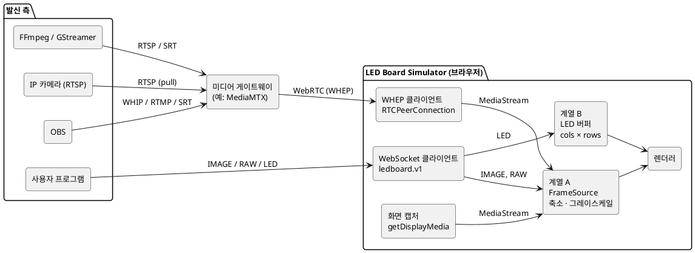
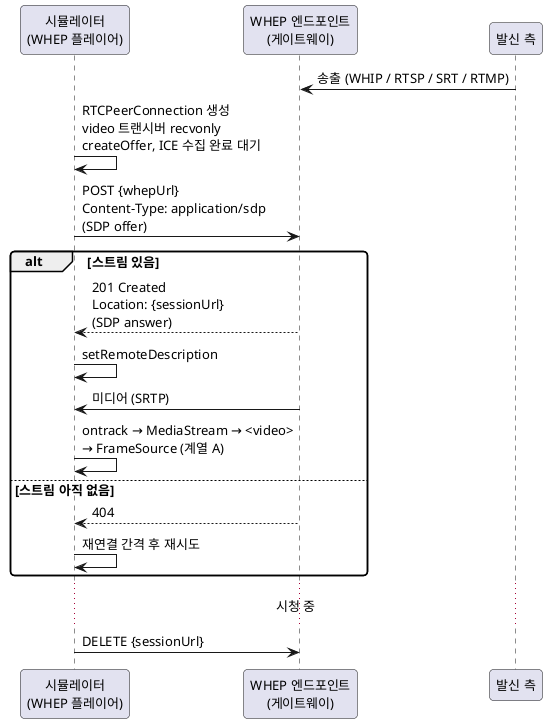
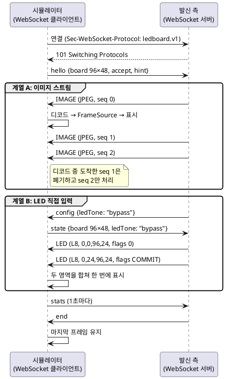
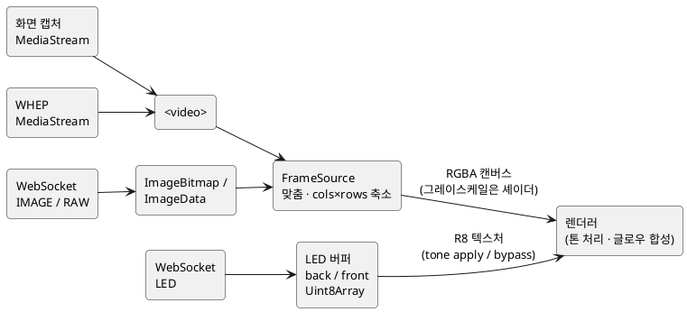
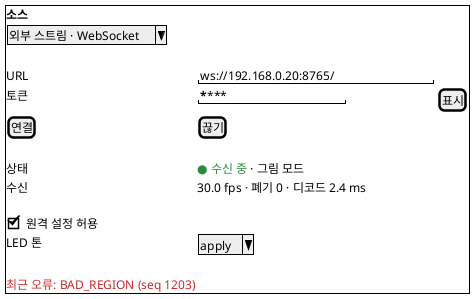

# 외부 소스 입력 인터페이스 사양

- 작성일: 2026-11-17
- 버전: v1 (초안)
- 상태: WebSocket 채널(5절)과 그에 해당하는 UX(7절) 구현 완료(`js/ws-channel.js`). WebRTC(WHEP)·화면 캡처는 미구현
- 시험 도구: `tools/ws_sender.py` (9절). 발신 측 프로토콜 구현은 `tools/ledboard_proto.py`
- 관련 문서: [설계 문서](design.md)

## 1. 개요

LED Board Simulator가 외부 프로그램·장비로부터 표시할 내용을 받는 인터페이스를 정의한다. 입력은 두 계열이다.

| 계열 | 보내는 것 | 시뮬레이터가 하는 일 | 발신 측이 보드 해상도를 알아야 하는가 |
|---|---|---|---|
| A. 이미지·영상 스트림 | 임의 해상도의 컬러·흑백 이미지 또는 영상 | 화면 맞춤, `cols × rows`로 축소, 그레이스케일 변환, 톤 처리 | 불필요 |
| B. LED 직접 입력 | `cols × rows` 크기의 밝기값 | 받은 값을 소자 밝기로 바로 사용 (톤 처리는 선택) | 필요. 연결 시 시뮬레이터가 알려줌 |

계열 A가 기본 용도다. 발신 측은 평소처럼 영상이나 이미지를 보내기만 하면 되고, LED 보드로 바꾸는 일은 모두 시뮬레이터가 맡는다. 계열 B는 전광판 컨트롤러 로직처럼 소자 단위로 값을 직접 정하는 프로그램을 검증할 때 쓴다.

## 2. 채널 선정

### 2.1 후보 비교

| 채널 | 지연 | 대역폭 효율 | 시뮬레이터 구현 | 발신 측 부담 | 판정 |
|---|---|---|---|---|---|
| WebRTC (WHEP 수신) | 낮음. 일반적으로 1초 미만 | 최상. HW 코덱, 프레임 간 압축, 적응형 비트레이트 | 수신한 `MediaStream`을 기존 `<video>` 경로에 그대로 연결 | 게이트웨이를 두면 OBS, FFmpeg, IP 카메라 등 표준 도구로 송출 | **영상 주 채널** |
| WebSocket + 이미지 프레임 (JPEG/PNG/WebP) | 낮음 | 중간. 프레임마다 독립 압축 | `createImageBitmap`으로 디코드 | 어떤 언어로든 구현 쉬움 | **프로그램 연동 채널** |
| WebSocket + raw 픽셀 | 낮음 | 낮음. 무압축 | 디코드 불필요 | 가장 쉬움 | 같은 채널에 포함. 저해상도 전용 |
| WebSocket + LED 밝기값 | 낮음 | 최상. 보드 해상도만 전송 | 렌더러에 직접 업로드 | 보드 해상도에 맞춰 값 생성 필요 | 같은 채널에 포함. 계열 B |
| WebSocket + WebCodecs (H.264 청크) | 낮음 | 최상 | 디코더 상태·키프레임 관리 필요 | 인코더 출력을 직접 패킷화해야 함 | 보류. WebRTC로 대체 가능 |
| MJPEG over HTTP | 낮음 | 중간 | ``로 수신. 캔버스 사용을 위해 CORS 필수 | IP 카메라 상당수가 기본 지원 | 게이트웨이 경유 WebRTC로 대체 |
| HLS / DASH | 수 초 | 높음 | 별도 플레이어 라이브러리 필요 | 쉬움 | 부적합. 지연이 큼 |
| RTSP / RTMP / SRT 직접 수신 | — | — | 브라우저가 수신 불가 | — | 게이트웨이에서 WebRTC로 변환 |
| 화면·창 캡처 (`getDisplayMedia`) | 매우 낮음 | 해당 없음. 같은 PC | 카메라 경로와 동일 | 없음. 사용자가 창 선택 | 로컬 보조 입력. 프로토콜 정의 대상 아님 |

### 2.2 결정

1. **라이브 영상은 WebRTC를 WHEP으로 받는다.** 브라우저가 받을 수 있는 영상 전송 방식 중 지연과 대역폭 효율이 가장 좋다. 디코딩도 브라우저 내장 HW 디코더가 처리한다. 수신 결과가 `MediaStream`이라 시뮬레이터에 이미 있는 영상·카메라 경로를 그대로 쓸 수 있다.
2. **프로그램 연동은 WebSocket 하나로 받는다.** 인코딩된 이미지, raw 픽셀, LED 직접 입력을 같은 연결에서 메시지 타입으로 구분한다. 발신 측은 WebSocket 서버 하나만 구현하면 세 가지를 모두 쓸 수 있다.
3. **RTSP, RTMP, SRT, IP 카메라 같은 기존 영상 소스는 미디어 게이트웨이(예: MediaMTX)로 WebRTC로 변환한다.** 시뮬레이터가 직접 수신해야 하는 프로토콜은 WHEP과 WebSocket 두 가지로 한정한다.

### 2.3 전체 구성



## 3. 공통 사항

### 3.1 연결 방향

**모든 채널에서 시뮬레이터가 클라이언트**다. 브라우저는 서버 소켓을 열 수 없기 때문이다. 발신 측(또는 게이트웨이)이 HTTP·WebSocket 서버를 연다.

### 3.2 접속 주소 지정

| 방법 | 형식 | 비고 |
|---|---|---|
| UI | 소스 선택에서 채널을 고르고 URL 입력 | 마지막 값은 `localStorage`에 저장 |
| 쿼리 파라미터 | 페이지 주소 뒤에 `?whep=<URL>` 또는 `?ws=<URL>`. 예: `http://localhost:8000/index.html?ws=ws://127.0.0.1:8765/` | 페이지를 열면 바로 연결. 키오스크·자동 실행용. 주소창에는 전체 주소 필요 |
| 인증 토큰 | `&token=<문자열>` | WHEP은 `Authorization: Bearer` 헤더로, WebSocket은 URL 쿼리로 전달 |

### 3.3 재연결

- 연결이 끊기거나 실패하면 0.5 → 1 → 2 → 4 → 8 → 10초(최대) 간격으로 다시 시도한다. 연결에 성공하면 간격을 처음으로 되돌린다.
- 끊긴 동안에는 마지막 프레임을 유지하고, 화면 하단 상태 표시줄에 연결 상태를 보여준다.
- 인증 실패(HTTP 401·403, WebSocket 종료 코드 4401·4403)는 재시도하지 않고 오류로 표시한다.

### 3.4 보안

- 페이지를 `https://`로 서비스하면 접속 주소도 `https://` 또는 `wss://`여야 한다(mixed content 차단).
- v1은 LAN·localhost 사용을 전제로 한다. 인증은 선택 사항인 토큰 하나뿐이고, 검증은 발신 측 서버가 한다.
- 시뮬레이터는 받은 데이터를 화면 표시에만 쓰고 저장하지 않는다.

## 4. 채널 1: WebRTC (WHEP)

### 4.1 역할

시뮬레이터는 WHEP 플레이어로 동작한다. WHEP은 SDP offer/answer 교환을 HTTP 요청 한 번으로 끝내는 WebRTC 수신 규격이다(IETF `draft-ietf-wish-whep`). 별도의 시그널링 서버가 필요 없다.

### 4.2 세션 절차



### 4.3 HTTP 요청

| 단계 | 요청 | 기대 응답 | 시뮬레이터 처리 |
|---|---|---|---|
| 세션 생성 | `POST {whepUrl}`. 헤더 `Content-Type: application/sdp`. 토큰이 있으면 `Authorization: Bearer <token>`. 본문은 SDP offer | `201 Created`. `Location` 헤더에 세션 URL(상대 경로 허용). 본문은 SDP answer | answer 적용 후 미디어 수신 대기 |
| 세션 종료 | `DELETE {sessionUrl}` | `200` 또는 `204` | 소스 전환·페이지 종료 시 호출. 실패해도 무시 |
| 스트림 없음 | — | `404` | 재연결 규칙(3.3)으로 재시도 |
| 인증 실패 | — | `401`, `403` | 재시도 중단, 오류 표시 |

- ICE는 non-trickle로 처리한다. offer를 보내기 전에 ICE 후보 수집이 끝나기를 최대 2초 기다린다. trickle ICE(`PATCH`)는 v1에서 쓰지 않는다.
- LAN에서는 STUN·TURN이 필요 없다. 다른 네트워크에서 받아야 하면 UI에서 ICE 서버를 지정한다.
- 연결 상태가 `failed`가 되거나 `disconnected`가 5초 넘게 이어지면 세션을 정리하고 다시 연결한다.

### 4.4 미디어 요구사항

| 항목 | 요구사항 |
|---|---|
| 비디오 코덱 | 브라우저와 송출 측이 협상하는 코덱(H.264, VP8, VP9, AV1). HW 디코딩 호환성을 위해 H.264 권장 |
| B-frame | 사용 금지. WebRTC는 B-frame을 지원하지 않음. x264라면 `-tune zerolatency`로 꺼짐 |
| 해상도 | 제한 없음. 시뮬레이터가 축소하므로 보드 해상도의 4~8배면 충분. 1280×720 이하 권장 |
| 프레임레이트 | 60 fps 이하. 화면 주사율보다 높으면 버려짐 |
| 색 | 컬러·흑백 모두 가능. 그레이스케일 변환은 시뮬레이터가 수행 |
| 오디오 | 수신하지 않음. 오디오 트랜시버를 만들지 않음 |
| 키프레임 간격 | 1~2초 권장. 접속 직후 첫 화면이 뜨기까지의 시간을 좌우함 |

### 4.5 게이트웨이 구성 예 (MediaMTX)

MediaMTX는 RTSP, RTMP, SRT, WHIP으로 받은 스트림을 WHEP으로 내보낼 수 있다. 기본 포트는 RTSP 8554, RTMP 1935, WebRTC(WHIP·WHEP) 8889, SRT 8890이다.

```yaml
# mediamtx.yml (발췌)
webrtc: yes
webrtcAddress: :8889
# 브라우저가 다른 출처에서 WHEP 엔드포인트를 호출하므로 CORS 허용이 필요하다.
# file://로 연 페이지의 출처는 "null"이므로 '*' 허용이 필요하다.
# 키 이름은 버전에 따라 다를 수 있으니 사용하는 버전의 mediamtx.yml 기본 파일에서 확인한다.
webrtcAllowOrigin: '*'

paths:
  ledsrc:            # 발신 측이 이 경로로 publish
  cam1:
    source: rtsp://192.168.0.50:554/stream1   # IP 카메라를 게이트웨이가 직접 pull
```

| 발신 측 | 송출 방법 | 시뮬레이터 WHEP URL |
|---|---|---|
| FFmpeg (파일 반복 재생) | `ffmpeg -re -stream_loop -1 -i input.mp4 -an -vf scale=640:-2 -c:v libx264 -preset veryfast -tune zerolatency -g 30 -f rtsp rtsp://<gw>:8554/ledsrc` | `http://<gw>:8889/ledsrc/whep` |
| OBS (30 이상) | 방송 설정에서 서비스를 WHIP으로, 서버를 `http://<gw>:8889/ledsrc/whip`으로 지정 | `http://<gw>:8889/ledsrc/whep` |
| IP 카메라 | 위 `cam1`처럼 게이트웨이가 RTSP로 pull | `http://<gw>:8889/cam1/whep` |

## 5. 채널 2: WebSocket

### 5.1 연결

| 항목 | 값 |
|---|---|
| URL | `ws://<host>:<port>/<path>` 또는 `wss://…`. 경로는 발신 측이 정함 |
| 서브프로토콜 | `ledboard.v1` (`Sec-WebSocket-Protocol`). 서버가 이를 선택하지 않으면 시뮬레이터가 연결을 닫음 |
| 메시지 구분 | text 메시지 = 제어(JSON, UTF-8). binary 메시지 = 데이터(5.2절 헤더 + payload) |
| 바이트 순서 | little-endian |
| 최대 메시지 크기 | 16 MiB. 넘으면 `TOO_LARGE` 오류 후 메시지 폐기 |
| 압축 | `permessage-deflate`는 쓰지 않음. 이미지는 이미 압축돼 있고 LED 데이터는 작음 |

### 5.2 binary 공통 헤더 (24 bytes)

| 오프셋 | 크기 | 필드 | 설명 |
|---|---|---|---|
| 0 | 2 | `magic` | ASCII `"LB"` (0x4C, 0x42) |
| 2 | 1 | `version` | 1 |
| 3 | 1 | `type` | 0x10 IMAGE, 0x11 RAW, 0x20 LED. 그 밖의 값은 예약 |
| 4 | 1 | `format` | 타입별 형식 코드 (5.3~5.5절) |
| 5 | 1 | `flags` | 타입별 플래그. 정의되지 않은 비트는 0 |
| 6 | 2 | `reserved` | 0 |
| 8 | 4 | `seq` | 발신 측 일련번호. 1씩 증가하고 넘치면 0부터 다시 시작. 통계·오류 보고용 |
| 12 | 4 | `timestamp` | 발신 측 단조 시계(ms) 하위 32 bit. 지연 측정용. 쓰지 않으면 0 |
| 16 | 2 | `x` | LED 영역 시작 열. IMAGE·RAW는 0 |
| 18 | 2 | `y` | LED 영역 시작 행. IMAGE·RAW는 0 |
| 20 | 2 | `width` | 픽셀 폭. IMAGE는 0 허용 |
| 22 | 2 | `height` | 픽셀 높이. IMAGE는 0 허용 |
| 24 | … | `payload` | 타입별 데이터. 길이 = 메시지 길이 - 24 |

### 5.3 IMAGE (0x10) — 인코딩된 이미지, 계열 A

| `format` | 형식 | MIME |
|---|---|---|
| 1 | JPEG | `image/jpeg` |
| 2 | PNG | `image/png` |
| 3 | WebP | `image/webp` |

- payload는 이미지 파일의 바이트 전체다.
- 시뮬레이터는 `createImageBitmap(new Blob([payload], { type }))`로 디코드해 `FrameSource`에 넘긴다. 이후 처리(맞춤, 축소, 그레이스케일, 톤)는 파일로 연 이미지와 같다.
- `width`·`height`는 참고값이다. 0이어도 되고, 실제 크기는 디코드 결과를 따른다.
- 정지 이미지는 한 번만 보내면 된다. 다음 메시지가 올 때까지 그 이미지를 계속 표시한다.
- 투명 영역은 검정(꺼진 소자)으로 처리한다.

### 5.4 RAW (0x11) — 무압축 픽셀, 계열 A

| `format` | 형식 | 바이트/픽셀 | 채널 순서 |
|---|---|---|---|
| 1 | GRAY8 | 1 | 밝기 |
| 2 | RGB24 | 3 | R, G, B |
| 3 | RGBA32 | 4 | R, G, B, A (A는 무시) |

- `width`, `height`는 필수다. 1~4096 범위.
- 행 우선(row-major) 순서, 원점은 왼쪽 위, 행 사이 패딩 없음. payload 길이는 정확히 `width × height × 바이트/픽셀`이어야 한다.
- 이미지 해상도를 그대로 보내는 형식이다. 축소와 그레이스케일 변환은 시뮬레이터가 한다. 대역폭이 커서 저해상도·저 fps용으로 쓴다(8절).

### 5.5 LED (0x20) — 소자 밝기 직접 입력, 계열 B

| `format` | 형식 | 한 바이트에 담는 소자 수 | 값 해석 |
|---|---|---|---|
| 1 | L8 | 1 | 0~255 |
| 2 | L4 | 2 (상위 nibble이 왼쪽 소자) | 0~15 → ×17 하여 0~255 |
| 3 | L1 | 8 (MSB가 왼쪽 소자) | 0 → 0, 1 → 255 |

| `flags` 비트 | 이름 | 의미 |
|---|---|---|
| 0 | `COMMIT` | 이 메시지까지 쌓인 back buffer를 화면에 반영 |
| 1 | `CLEAR` | 이 메시지를 적용하기 전에 back buffer 전체를 0으로 초기화 |

- `(x, y, width, height)`는 보드 안의 갱신 영역이다. `x + width ≤ cols`, `y + height ≤ rows`, `width ≥ 1`, `height ≥ 1`을 만족해야 하며, 벗어나면 `BAD_REGION` 오류로 메시지 전체를 버린다.
- 영역 데이터는 행 우선 순서이고, 각 행은 바이트 경계에서 시작한다. 행 하나의 바이트 수(stride)는 `ceil(width × bit/8)`이다. payload 길이는 `stride × height`와 같아야 한다.
- 전체 화면 갱신은 `x = 0, y = 0, width = cols, height = rows`, `flags = COMMIT`인 메시지 하나로 한다.
- 영역 여러 개를 조합하려면 `COMMIT` 없이 영역 메시지를 보내고, 마지막 메시지에만 `COMMIT`을 켠다. 화면 찢김(tearing)이 생기지 않는다.
- 보드 크기는 연결 직후 `hello`로 알려준다. 보드 크기가 바뀌면 `state` 메시지가 온다. 이때 back buffer와 화면 버퍼는 0으로 초기화된다.
- 톤 처리는 `ledTone` 설정을 따른다(5.6절).

| `ledTone` | 소자 밝기 b |
|---|---|
| `apply` (기본) | 받은 값을 원본 휘도로 보고 시뮬레이터의 밝기·대비·감마·계조 처리를 거침 |
| `bypass` | `b = 값 / 255`. 시뮬레이터 UI의 세기(intensity)만 적용. 컨트롤러 출력값을 그대로 확인할 때 사용 |

### 5.6 제어 메시지 (JSON)

모든 제어 메시지는 `type` 필드를 가진다. 알 수 없는 `type`은 무시하고, 알 수 없는 필드도 무시한다.

**시뮬레이터 → 발신 측**

| `type` | 시점 | 내용 |
|---|---|---|
| `hello` | 연결 직후 1회 | 프로토콜 버전, 보드 크기, 지원 형식, 권장 소스 크기 |
| `state` | 보드 크기·`ledTone`이 바뀔 때, `config` 응답 | 현재 보드 상태 |
| `stats` | 1초마다 | 수신·디코드·표시·폐기 개수, 마지막 `seq`, 평균 디코드 시간 |
| `error` | 오류 발생 시. 같은 코드는 초당 1회로 제한 | 오류 코드, 설명, 관련 `seq` |

```json
{
  "type": "hello",
  "protocol": "ledboard",
  "version": 1,
  "board": { "cols": 96, "rows": 48 },
  "accept": {
    "image": ["jpeg", "png", "webp"],
    "raw": ["gray8", "rgb24", "rgba32"],
    "led": ["l8", "l4", "l1"]
  },
  "hint": { "maxWidth": 768, "maxHeight": 384, "maxFps": 60 }
}
```

`hint`는 계열 A 소스를 이보다 크게 보내도 화질이 나아지지 않는다는 안내다. 보드 크기의 8배(최대 1920×1080)로 계산한다. 따르지 않아도 동작한다.

```json
{ "type": "state", "board": { "cols": 96, "rows": 48 }, "ledTone": "apply", "remoteConfig": true }
```

```json
{
  "type": "stats",
  "received": 1820, "bytes": 8388608,
  "decoded": 1820, "displayed": 1795, "dropped": 25,
  "lastSeq": 1819, "decodeMs": 2.4
}
```

`received`, `bytes`, `decoded`, `displayed`, `dropped`는 연결 이후 누적값이다.

```json
{ "type": "error", "code": "BAD_REGION", "message": "x + width > cols (90 + 10 > 96)", "seq": 1203 }
```

**발신 측 → 시뮬레이터**

| `type` | 내용 | 비고 |
|---|---|---|
| `config` | `cols`, `rows`(1~1024), `ledTone`(`apply`·`bypass`) 중 바꿀 항목 | 모두 검증한 뒤 한꺼번에 적용. 하나라도 틀리면 아무것도 바꾸지 않고 `BAD_CONFIG`. UI에서 원격 설정을 꺼 두면 `CONFIG_DENIED` |
| `end` | 송출 종료 알림 | 마지막 프레임을 유지하고 연결은 그대로 둠 |

```json
{ "type": "config", "cols": 128, "rows": 64, "ledTone": "bypass" }
```

### 5.7 표시 모드 전환

한 연결에서 IMAGE·RAW와 LED를 섞어 보낼 수 있다. 시뮬레이터는 **마지막으로 받은 데이터 메시지의 계열**로 표시 모드를 정한다.

| 마지막 메시지 | 표시 모드 | 경로 |
|---|---|---|
| IMAGE, RAW | 그림 모드 | `FrameSource`(맞춤·축소·그레이스케일) → 톤 처리 → 렌더러 |
| LED + `COMMIT` | 직접 모드 | LED 버퍼 → (`ledTone`에 따라 톤 처리) → 렌더러 |

COMMIT 없는 LED 메시지는 back buffer만 바꾸고 모드는 바꾸지 않는다.

### 5.8 흐름 제어

TCP 위라서 메시지 순서는 보장된다. 시뮬레이터는 따로 확인 응답(ack)을 보내지 않고 **최신 프레임 우선(latest-wins)** 방식으로 처리한다.

- **IMAGE:** 디코드 중에 새 메시지가 오면, 대기 중인 메시지는 가장 최근 것 하나만 남기고 버린다(`dropped` 증가).
- **RAW, LED:** 화면 주기 한 번 사이에 COMMIT이 여러 번 오면 마지막 것만 표시한다. COMMIT 없는 영역 메시지는 버리지 않고 모두 back buffer에 적용한다.
- **발신 측:** `stats.dropped`가 계속 늘면 송출 fps나 해상도를 낮춘다. 서버 라이브러리가 송신 버퍼 크기를 알려주면 버퍼가 쌓일 때 프레임을 건너뛴다.

### 5.9 오류 코드

| 코드 | 원인 | 처리 |
|---|---|---|
| `BAD_MAGIC` | 헤더 `magic`이 `"LB"`가 아님 | 메시지 폐기 |
| `BAD_VERSION` | 지원하지 않는 `version` | 메시지 폐기 |
| `UNKNOWN_TYPE` | 정의되지 않은 `type` | 메시지 폐기 |
| `BAD_FORMAT` | 타입에 맞지 않는 `format` | 메시지 폐기 |
| `BAD_LENGTH` | payload 길이가 계산값과 다름 | 메시지 폐기 |
| `BAD_REGION` | LED 영역이 보드를 벗어남 | 메시지 폐기 |
| `DECODE_FAILED` | IMAGE 디코드 실패 | 메시지 폐기. 이전 화면 유지 |
| `TOO_LARGE` | 메시지가 16 MiB 초과 또는 RAW 크기가 4096 초과 | 메시지 폐기 |
| `BAD_CONFIG` | `config` 값이 범위를 벗어남 | 설정 변경 없음 |
| `CONFIG_DENIED` | UI에서 원격 설정을 꺼 둠 | 설정 변경 없음 |

### 5.10 세션 예



## 6. 시뮬레이터 내부 연결 (구현 가이드)



| 항목 | 구현 방향 |
|---|---|
| 새 소스 종류 | `FrameSource`에 `stream-whep`, `stream-ws`, `screen` 추가. UI에 URL·토큰 입력과 연결 상태 표시 |
| 계열 A 연결 | WHEP·화면 캡처는 `<video>`에 `srcObject`로 연결(카메라와 같은 경로). IMAGE·RAW는 `ImageBitmap`·`ImageData`로 받아 `draw()`에서 그림. `ImageBitmap`은 `width`·`height` 속성을 쓰도록 크기 판별 수정 |
| 계열 B 연결 | 캔버스를 거치지 않고 LED 버퍼(`Uint8Array`)를 렌더러에 직접 전달. GL은 `R8` 텍스처에 `texSubImage2D`(`UNPACK_ALIGNMENT = 1`). 셰이더에 휘도 입력 여부와 `bypass` uniform 추가 |
| 디코드 | `createImageBitmap`은 비동기로 메인 스레드를 거의 막지 않음. 고 fps 수신에서 파싱 부하가 크면 WebSocket 수신과 디코드를 Worker로 옮기고 `ImageBitmap`을 transfer |
| 자원 정리 | 소스 전환 시 `RTCPeerConnection.close()`, WHEP `DELETE`, WebSocket 종료, `ImageBitmap.close()` |

binary 헤더 파싱 예:

```js
function parseHeader(buf) {             // buf: ArrayBuffer
  const dv = new DataView(buf);
  if (buf.byteLength < 24 || dv.getUint8(0) !== 0x4c || dv.getUint8(1) !== 0x42) return null;
  return {
    version: dv.getUint8(2),
    type: dv.getUint8(3),
    format: dv.getUint8(4),
    flags: dv.getUint8(5),
    seq: dv.getUint32(8, true),
    timestamp: dv.getUint32(12, true),
    x: dv.getUint16(16, true),
    y: dv.getUint16(18, true),
    width: dv.getUint16(20, true),
    height: dv.getUint16(22, true),
    payload: new Uint8Array(buf, 24),
  };
}
```

## 7. UX 변경

외부 스트림 입력을 넣으면서 바뀌는 화면과 조작을 정의한다. 현재 UI(소스 선택 드롭다운 + 오른쪽 설정 패널 + 하단 상태 표시줄)의 구조는 유지한다.

### 7.1 소스 선택

소스 드롭다운을 그룹으로 나눈다.

| 그룹 | 항목 | 변경 |
|---|---|---|
| 내장 | 밝기 계단 + 파형, 플라즈마, 시계, 텍스트 스크롤 | 그룹만 추가 |
| 로컬 | 파일, 카메라, **화면 캡처** | 화면 캡처 신규 |
| 외부 스트림 | **WebRTC (WHEP)**, **WebSocket** | 신규 |

- **화면 캡처:** 선택하면 브라우저의 창·화면 선택 대화상자가 뜬다. 사용자가 취소하거나 브라우저 바에서 공유를 중지하면 이전 소스로 돌아가고 토스트로 알린다.
- **외부 스트림:** 선택하면 바로 연결하지 않고 아래 연결 패널을 연다. 사용자가 [연결]을 눌러야 연결한다. 단, 쿼리 파라미터로 연 경우(7.5절)는 자동으로 연결한다.

### 7.2 연결 패널

외부 스트림을 고르면 소스 섹션 아래에 나타난다.



| 요소 | 동작 |
|---|---|
| URL | 채널별로 따로 기억(`localStorage`). WHEP은 `http(s)://`, WebSocket은 `ws(s)://`만 허용하고 형식이 틀리면 입력란에 오류 표시 |
| 토큰 | 비밀번호 입력란. [표시]로 잠깐 보기. **저장하지 않음.** 페이지를 다시 열면 다시 입력 |
| [연결] / [끊기] | 연결 중에는 [연결] 비활성. [끊기]는 재연결 대기도 취소 |
| 상태 배지 | 7.3절의 상태와 색 |
| 수신 정보 | 수신 fps, 폐기 개수, 평균 디코드 시간. WHEP은 수신 해상도와 코덱 표시 |
| 원격 설정 허용 | WebSocket 전용. 끄면 발신 측 `config`를 `CONFIG_DENIED`로 거절. 기본 켬 |
| LED 톤 | WebSocket 전용. `apply`·`bypass`. 발신 측 `config`로 바뀌면 이 값도 바뀜. 사용자가 바꾸면 발신 측에 `state` 전송 |
| 최근 오류 | 마지막 오류 하나를 10초간 표시 |
| ICE 서버 (WHEP, 접힘) | 고급 설정. 기본은 비어 있음(LAN). STUN·TURN URL을 줄 단위로 입력 |

### 7.3 연결 상태

| 상태 | 배지 | 화면(무대) 표시 |
|---|---|---|
| 대기 | 회색 ○ 연결 안 됨 | 이전 소스 화면 유지 |
| 연결 중 | 노랑 ● 연결 중 | 이전 화면 유지 |
| 신호 대기 | 노랑 ● 연결됨 · 신호 없음 | 보드를 꺼진 상태로 표시. 무대 왼쪽 위에 "신호 대기" 배지 |
| 수신 중 | 초록 ● 수신 중 · 그림 모드 / 직접 모드 | 정상 표시 |
| 송출 종료 (`end`) | 회색 ● 송출 종료 | 마지막 프레임 유지 |
| 재연결 대기 | 주황 ● 재연결 n초 후 | 마지막 프레임 유지. 무대 왼쪽 위에 "연결 끊김 · n초 후 재연결" 배지 |
| 오류 (인증 실패 등) | 빨강 ● 오류 내용 | 마지막 프레임 유지. 자동 재시도 안 함 |

무대 위 배지는 보드를 가리지 않도록 무대 모서리에 작게 둔다. 수신 중에는 무대 배지를 표시하지 않는다.

### 7.4 표시 모드에 따른 컨트롤 상태

LED 직접 입력(직접 모드)에서는 화면 맞춤과 톤 처리가 의미 없어진다. 해당 컨트롤을 숨기지 않고 비활성화한 뒤 이유를 툴팁으로 보여 준다.

| 컨트롤 | 그림 모드 | 직접 모드, `apply` | 직접 모드, `bypass` |
|---|---|---|---|
| 맞춤 (contain·cover·stretch) | 사용 | 비활성. "LED 직접 입력에는 적용되지 않음" | 비활성 |
| 밝기·대비·감마·계조·임계값·반전 | 사용 | 사용 | 비활성. "bypass: 받은 값을 그대로 표시" |
| 세기, LED 색, 글로우 | 사용 | 사용 | 사용 |
| 해상도 (cols·rows) | 사용 | 사용. 바꾸면 발신 측에 `state` 전송, LED 버퍼 초기화 | 같음 |

발신 측 `config`로 해상도가 바뀌면 해상도 입력란이 갱신되고, 토스트로 "발신 측이 해상도를 128 × 64로 변경"이라고 알린다. 피치 자동 모드라면 레이아웃도 다시 계산한다.

### 7.5 키오스크·자동 실행

외부 송출을 받아 보여 주기만 하는 화면(전시, 사이니지 시연)을 위해 쿼리 파라미터와 단축키를 둔다.

| 쿼리 파라미터 | 의미 |
|---|---|
| `ws=<URL>` / `whep=<URL>` | 해당 채널로 자동 연결 |
| `token=<문자열>` | 인증 토큰. 주소창에 남으므로 신뢰된 환경에서만 사용 |
| `cols=`, `rows=` | 시작 해상도 |
| `panel=0` | 설정 패널을 접은 채로 시작 |
| `stats=0` | 하단 상태 표시줄 숨김 |

| 단축키 | 동작 |
|---|---|
| `F` | 전체 화면 전환 |
| `H` | 설정 패널 접기·펴기 |
| `S` | 상태 표시줄 표시·숨김 |

텍스트 입력란에 포커스가 있을 때는 단축키를 무시한다. 쿼리 파라미터로 준 값은 그 실행에만 적용하고 저장된 설정을 덮어쓰지 않는다.

### 7.6 상태 표시줄

외부 소스일 때 하단 상태 표시줄에 수신 정보를 덧붙인다.

```text
96×48 = 4,608 LED · 피치 10.5px · WebGL2 · 60 fps · 1.3 ms │ WS 수신 30.0 fps · 폐기 0 · 그림 모드
```

## 8. 대역폭 가이드

계열 A는 시뮬레이터가 결국 보드 해상도로 줄이므로, 원본을 크게 보낼수록 대역폭만 낭비된다. 아래 값은 30·60 fps 기준 대략치이며, 압축 형식은 내용과 인코더 설정에 따라 크게 달라진다.

| 입력 | 조건 | 프레임당 | 대역폭 | 비고 |
|---|---|---|---|---|
| WebRTC H.264 | 640×360, 30 fps | — | 약 0.5~1.5 Mbps | 영상에 가장 효율적 |
| WebSocket IMAGE (JPEG) | 640×360, 품질 80, 30 fps | 약 30~60 KB | 약 7~15 Mbps | 프로그램 생성 이미지에 적합 |
| WebSocket RAW GRAY8 | 320×180, 30 fps | 57.6 KB | 13.8 Mbps | 무압축 |
| WebSocket RAW RGB24 | 640×360, 30 fps | 691 KB | 166 Mbps | localhost 외에는 비권장 |
| WebSocket LED L8 | 96×48, 60 fps | 4.6 KB | 2.2 Mbps | 헤더 24 B 별도 |
| WebSocket LED L1 | 96×48, 60 fps | 576 B | 0.28 Mbps | 1 bit 전광판 |
| WebSocket LED L8 | 320×180, 60 fps | 57.6 KB | 27.6 Mbps | |

## 9. 발신 측 예제 (Python)

이 절의 코드는 규격을 설명하기 위한 최소 예제다. 실제 시험에는 같은 규격을 구현한 `tools/ws_sender.py`를 쓴다. 두 코드 모두 `websockets` 패키지(`pip install websockets`)가 필요하다.

| `tools/ws_sender.py` 모드 | 예 | 확인하는 것 |
|---|---|---|
| `led` | `python tools/ws_sender.py led --format l4 --regions` | LED 직접 입력, 영역 분할 + COMMIT, L8·L4·L1 |
| `raw` | `python tools/ws_sender.py raw --format rgb24 --size 320x180` | RAW 픽셀 수신, 축소·그레이스케일 |
| `image` | `python tools/ws_sender.py image ./photos --interval 2` | JPEG·PNG·WebP 수신 |
| 공통 옵션 | `--cols 64 --rows 32 --ledtone bypass` | 연결 직후 `config` 전송 |

웹캠 영상을 IMAGE(JPEG)로 보내는 테스트베드는 `tools/webcam_sender.py`다. 사용법과 처리 과정은 [웹캠 테스트베드](webcam-testbed.md)에 있다.

두 도구는 헤더·메시지 생성을 `tools/ledboard_proto.py` 하나에서 가져다 쓴다. 규격(헤더 구조, `type`·`format` 코드, LED 비트 패킹)이 바뀌면 수신 측 `js/ws-channel.js`와 이 모듈 두 곳만 고친다. 모듈의 단위 테스트는 `python -m unittest discover -s tools`로 돌린다.

도구는 시뮬레이터가 보내는 `hello`·`state`·`stats`·`error`를 출력한다. `raw` 모드는 패턴을 순수 Python으로 만들어서 320×180이면 초당 몇 프레임밖에 못 보낸다. 시뮬레이터 쪽 한계가 아니다.

아래는 규격 설명용 최소 예제다.

```python
import asyncio, json, struct, sys, time
from pathlib import Path
import websockets

HDR = struct.Struct("<2sBBBBHIIHHHH")       # 24 bytes, little-endian
T_IMAGE, T_LED = 0x10, 0x20
F_JPEG, F_L8 = 1, 1
COMMIT = 0x01


def header(type_, fmt, flags, seq, x=0, y=0, w=0, h=0):
    ts = int(time.monotonic() * 1000) & 0xFFFFFFFF
    return HDR.pack(b"LB", 1, type_, fmt, flags, 0, seq, ts, x, y, w, h)


async def slideshow(ws, folder):
    """계열 A: 폴더의 JPEG를 2초 간격으로 보낸다. 보드 크기는 몰라도 된다."""
    files = sorted(Path(folder).glob("*.jpg"))
    seq = 0
    while True:
        for f in files:
            await ws.send(header(T_IMAGE, F_JPEG, 0, seq) + f.read_bytes())
            seq = (seq + 1) & 0xFFFFFFFF
            await asyncio.sleep(2)


async def led_bar(ws, cols, rows):
    """계열 B: 세로 막대가 좌우로 움직이는 전체 프레임을 60 fps로 보낸다."""
    seq = 0
    t0 = time.monotonic()
    while True:
        x = int((time.monotonic() - t0) * 30) % cols
        buf = bytearray(cols * rows)
        for y in range(rows):
            buf[y * cols + x] = 255
        await ws.send(header(T_LED, F_L8, COMMIT, seq, 0, 0, cols, rows) + bytes(buf))
        seq = (seq + 1) & 0xFFFFFFFF
        await asyncio.sleep(1 / 60)


async def handler(ws):
    hello = json.loads(await ws.recv())          # 연결 직후 시뮬레이터가 보냄
    board = hello["board"]
    if len(sys.argv) > 1:
        await slideshow(ws, sys.argv[1])
    else:
        await led_bar(ws, board["cols"], board["rows"])


async def main():
    async with websockets.serve(handler, "0.0.0.0", 8765, subprotocols=["ledboard.v1"]):
        await asyncio.Future()

asyncio.run(main())
```

시뮬레이터 접속 주소: `http://localhost:8000/index.html?ws=ws://<발신 PC>:8765/` (파일로 열면 `file:///<경로>/index.html?ws=...`)

이 예제는 보내기만 한다. `state` 메시지(보드 크기 변경)에 대응하려면 수신 루프를 별도 task로 돌려 `cols`·`rows`를 갱신한다.

## 10. 버전과 호환성

| 변경 종류 | 처리 |
|---|---|
| 필드·메시지 추가 (하위 호환) | `version` 유지. 수신 측은 모르는 JSON 필드와 `type`을 무시 |
| 새 binary `type`·`format` 추가 | `version` 유지. 모르는 값은 `UNKNOWN_TYPE`·`BAD_FORMAT` 오류로 알림 |
| 헤더 구조·의미 변경 | `version`과 서브프로토콜(`ledboard.v2`)을 함께 올림 |

## 11. 미결 사항

| 항목 | 내용 |
|---|---|
| 수신 측 구현 | WebSocket 채널과 해당 UX 구현 완료. WHEP 클라이언트, 화면 캡처, 연결 패널의 ICE 서버 설정 미구현 |
| 실측 | 지연·대역폭 수치는 추정치. 실제 GPU·네트워크에서 측정 필요 |
| MediaMTX 설정 키 | CORS 허용 키 이름을 사용할 버전에서 확인 필요 |
| 다중 소스 | v1은 연결 하나만 활성. 여러 소스 합성·화면 분할은 범위 밖 |
| 인증 강화 | 토큰 외의 인증(mTLS 등)은 범위 밖 |

### 11.1 WebSocket 구현 검증 (2026-11-17)

헤드리스 Chrome(SwiftShader)을 DevTools 프로토콜로 제어하고 `tools/ws_sender.py`와 오류 시험용 발신 스크립트를 붙여 확인했다.

| 시나리오 | 결과 |
|---|---|
| LED L8 전체 프레임 + 원격 `config`(48×24 → 64×32) | 해상도 변경, 토스트 표시, 직접 모드 전환, 맞춤 비활성화 확인 |
| LED L1 영역 분할 + COMMIT, `ledTone` bypass | 두 영역이 한 번에 표시됨. 톤 컨트롤 5개 비활성화 확인 |
| RAW RGB24 320×180 | contain 맞춤과 그레이스케일 변환 정상. 수신·디코드·표시 개수 일치, 폐기 0 |
| IMAGE JPEG 960×540 | 정상 표시. 디코드 약 4 ms |
| 잘못된 메시지 8종 + 잘못된 `config` | 오류 코드 전부 회신. 같은 코드는 초당 1회로 제한됨. 이후 정상 프레임 표시 |
| 발신 측 종료 | 마지막 프레임 유지, "연결 끊김 · n초 후 재연결" 배지 표시 |
| 원격 설정 끔 | `CONFIG_DENIED` 회신 |
| 사용자가 해상도 변경 | `state` 전송, 발신 측이 새 크기로 전송, `BAD_REGION` 없음 |
| Canvas2D 렌더러 + LED L4 | 직접 모드 정상 표시 |
| 스트림 미사용(패턴) | 기존 동작 유지(회귀 없음) |

헤드리스 환경은 렌더링이 느려 화면 주기 사이에 프레임이 겹쳐 `dropped`가 늘어난다. latest-wins 규칙대로의 동작이며, 실제 GPU에서의 fps는 측정하지 않았다.
