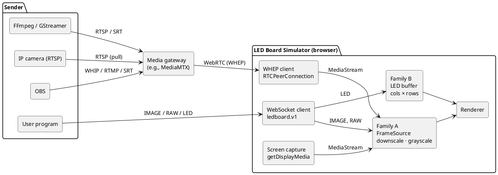
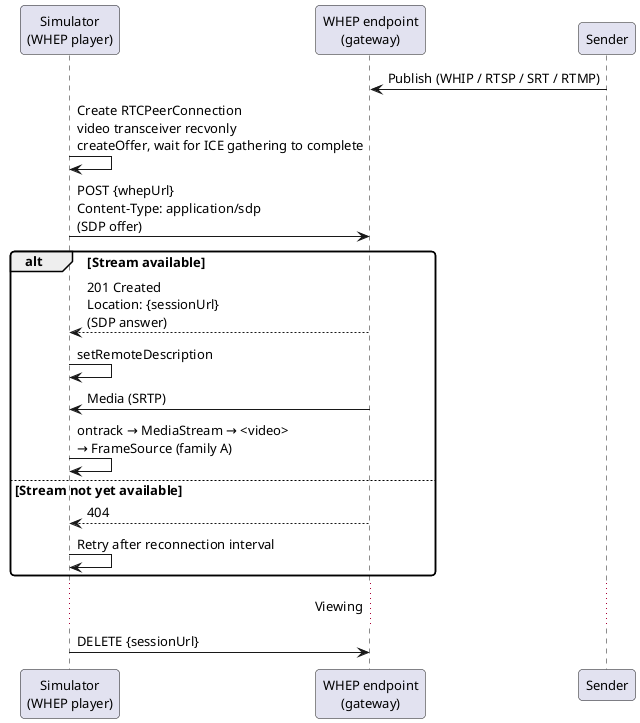
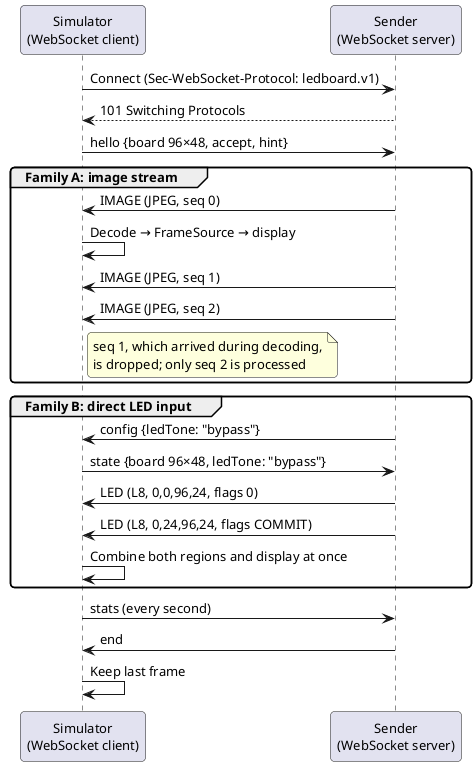
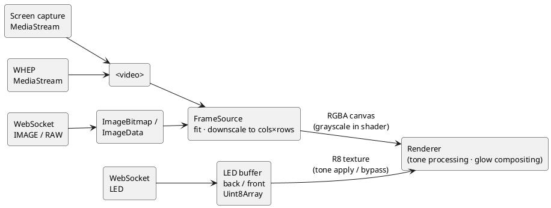
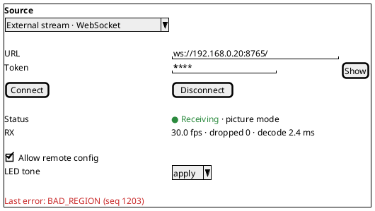

# External Source Input Interface Specification

**English** | [한국어](source-interface.ko.md)

- Date: 2026-11-17
- Version: v1 (draft)
- Status: WebSocket channel (Section 5) and its corresponding UX (Section 7) implemented (`js/ws-channel.js`). WebRTC (WHEP) and screen capture not implemented
- Test tool: `tools/ws_sender.py` (Section 9). Sender-side protocol implementation is `tools/ledboard_proto.py`
- Related documents: [Design document](design.md)

## 1. Overview

This document defines the interface through which LED Board Simulator receives content to display from external programs and devices. There are two input families.

| Family | What is sent | What the simulator does | Does the sender need to know the board resolution? |
|---|---|---|---|
| A. Image/video stream | Color or monochrome images or video at any resolution | Screen fit, downscale to `cols × rows`, grayscale conversion, tone processing | Not required |
| B. Direct LED input | Brightness values of size `cols × rows` | Uses the received values directly as LED brightness (tone processing optional) | Required. The simulator reports it on connection |

Family A is the primary use case. The sender simply sends video or images as usual, and the simulator takes care of everything needed to turn them into an LED board. Family B is used to verify programs that set values per LED directly, such as signboard controller logic.

## 2. Channel selection

### 2.1 Candidate comparison

| Channel | Latency | Bandwidth efficiency | Simulator implementation | Sender burden | Verdict |
|---|---|---|---|---|---|
| WebRTC (WHEP receive) | Low. Typically under 1 second | Best. HW codecs, inter-frame compression, adaptive bitrate | Received `MediaStream` connected as is to the existing `<video>` path | With a gateway, streaming via standard tools such as OBS, FFmpeg, IP cameras | **Primary video channel** |
| WebSocket + image frames (JPEG/PNG/WebP) | Low | Medium. Each frame compressed independently | Decoded with `createImageBitmap` | Easy to implement in any language | **Program integration channel** |
| WebSocket + raw pixels | Low | Low. Uncompressed | No decoding needed | Easiest | Included in the same channel. Low resolution only |
| WebSocket + LED brightness values | Low | Best. Only the board resolution is transmitted | Uploaded directly to the renderer | Values must be generated to match the board resolution | Included in the same channel. Family B |
| WebSocket + WebCodecs (H.264 chunks) | Low | Best | Decoder state and keyframe management required | Encoder output must be packetized directly | Deferred. Replaceable by WebRTC |
| MJPEG over HTTP | Low | Medium | Received via ``. CORS mandatory for canvas use | Natively supported by many IP cameras | Replaced by WebRTC via the gateway |
| HLS / DASH | Several seconds | High | Separate player library required | Easy | Unsuitable. High latency |
| Direct RTSP / RTMP / SRT reception | — | — | Browser cannot receive | — | Converted to WebRTC at the gateway |
| Screen/window capture (`getDisplayMedia`) | Very low | N/A. Same PC | Same as the camera path | None. User selects the window | Local auxiliary input. Not subject to protocol definition |

### 2.2 Decision

1. **Live video is received over WebRTC via WHEP.** Of the video transport methods a browser can receive, it has the best latency and bandwidth efficiency. Decoding is also handled by the browser's built-in HW decoder. Since the result is a `MediaStream`, the simulator's existing video/camera path can be used as is.
2. **Program integration is received over a single WebSocket.** Encoded images, raw pixels, and direct LED input are distinguished by message type on the same connection. The sender only has to implement one WebSocket server to use all three.
3. **Existing video sources such as RTSP, RTMP, SRT, and IP cameras are converted to WebRTC by a media gateway (e.g., MediaMTX).** The protocols the simulator must receive directly are limited to two: WHEP and WebSocket.

### 2.3 Overall architecture



## 3. Common rules

### 3.1 Connection direction

**On every channel, the simulator is the client.** This is because a browser cannot open a server socket. The sender (or the gateway) opens the HTTP/WebSocket server.

### 3.2 Specifying the endpoint address

| Method | Format | Notes |
|---|---|---|
| UI | Choose the channel in source selection and enter the URL | Last value saved in `localStorage` |
| Query parameter | `?whep=<URL>` or `?ws=<URL>` after the page address. Example: `http://localhost:8000/index.html?ws=ws://127.0.0.1:8765/` | Connects immediately when the page opens. For kiosk/auto-start. The full address is required in the address bar |
| Auth token | `&token=<string>` | Passed in the `Authorization: Bearer` header for WHEP, and in the URL query for WebSocket |

### 3.3 Reconnection

- When the connection drops or fails, the simulator retries at intervals of 0.5 → 1 → 2 → 4 → 8 → 10 seconds (maximum). On a successful connection, the interval is reset to the first value.
- While disconnected, the last frame is kept, and the connection state is shown in the status bar at the bottom of the screen.
- Authentication failures (HTTP 401/403, WebSocket close codes 4401/4403) are not retried and are shown as errors.

### 3.4 Security

- If the page is served over `https://`, the endpoint address must also be `https://` or `wss://` (mixed content blocking).
- v1 assumes LAN/localhost use. The only authentication is a single optional token, and it is validated by the sender's server.
- The simulator uses received data only for display and does not store it.

## 4. Channel 1: WebRTC (WHEP)

### 4.1 Role

The simulator acts as a WHEP player. WHEP is a WebRTC receive specification that completes the SDP offer/answer exchange in a single HTTP request (IETF `draft-ietf-wish-whep`). No separate signaling server is required.

### 4.2 Session procedure



### 4.3 HTTP requests

| Step | Request | Expected response | Simulator handling |
|---|---|---|---|
| Session creation | `POST {whepUrl}`. Header `Content-Type: application/sdp`. `Authorization: Bearer <token>` if a token is set. Body is the SDP offer | `201 Created`. Session URL in the `Location` header (relative path allowed). Body is the SDP answer | Apply the answer, then wait for media |
| Session termination | `DELETE {sessionUrl}` | `200` or `204` | Called on source switch or page close. Failures ignored |
| No stream | — | `404` | Retry per the reconnection rules (3.3) |
| Authentication failure | — | `401`, `403` | Stop retrying, show error |

- ICE is handled as non-trickle. Before sending the offer, the simulator waits up to 2 seconds for ICE candidate gathering to finish. Trickle ICE (`PATCH`) is not used in v1.
- STUN/TURN is not needed on a LAN. If the stream must be received from another network, ICE servers are specified in the UI.
- If the connection state becomes `failed`, or `disconnected` persists for more than 5 seconds, the session is cleaned up and reconnected.

### 4.4 Media requirements

| Item | Requirement |
|---|---|
| Video codec | Codec negotiated between the browser and the sender (H.264, VP8, VP9, AV1). H.264 recommended for HW decoding compatibility |
| B-frames | Must not be used. WebRTC does not support B-frames. With x264, disabled by `-tune zerolatency` |
| Resolution | No limit. Since the simulator downscales, 4–8× the board resolution is sufficient. 1280×720 or lower recommended |
| Frame rate | 60 fps or lower. Frames beyond the display refresh rate are discarded |
| Color | Both color and monochrome allowed. Grayscale conversion performed by the simulator |
| Audio | Not received. No audio transceiver is created |
| Keyframe interval | 1–2 seconds recommended. Determines the time until the first image appears after connecting |

### 4.5 Gateway configuration example (MediaMTX)

MediaMTX can output streams received via RTSP, RTMP, SRT, or WHIP as WHEP. The default ports are RTSP 8554, RTMP 1935, WebRTC (WHIP/WHEP) 8889, and SRT 8890.

```yaml
# mediamtx.yml (excerpt)
webrtc: yes
webrtcAddress: :8889
# The browser calls the WHEP endpoint from a different origin, so CORS must be allowed.
# The origin of a page opened via file:// is "null", so '*' must be allowed.
# Key names may differ between versions; check the default mediamtx.yml of the version you use.
webrtcAllowOrigin: '*'

paths:
  ledsrc:            # the sender publishes to this path
  cam1:
    source: rtsp://192.168.0.50:554/stream1   # the gateway pulls the IP camera directly
```

| Sender | How to publish | Simulator WHEP URL |
|---|---|---|
| FFmpeg (looped file playback) | `ffmpeg -re -stream_loop -1 -i input.mp4 -an -vf scale=640:-2 -c:v libx264 -preset veryfast -tune zerolatency -g 30 -f rtsp rtsp://<gw>:8554/ledsrc` | `http://<gw>:8889/ledsrc/whep` |
| OBS (30 or later) | In stream settings, set the service to WHIP and the server to `http://<gw>:8889/ledsrc/whip` | `http://<gw>:8889/ledsrc/whep` |
| IP camera | Gateway pulls over RTSP, as with `cam1` above | `http://<gw>:8889/cam1/whep` |

## 5. Channel 2: WebSocket

### 5.1 Connection

| Item | Value |
|---|---|
| URL | `ws://<host>:<port>/<path>` or `wss://…`. Path determined by the sender |
| Subprotocol | `ledboard.v1` (`Sec-WebSocket-Protocol`). If the server does not select it, the simulator closes the connection |
| Message distinction | Text message = control (JSON, UTF-8). Binary message = data (Section 5.2 header + payload) |
| Byte order | little-endian |
| Maximum message size | 16 MiB. If exceeded, `TOO_LARGE` error and the message is dropped |
| Compression | `permessage-deflate` not used. Images are already compressed and LED data is small |

### 5.2 Common binary header (24 bytes)

| Offset | Size | Field | Description |
|---|---|---|---|
| 0 | 2 | `magic` | ASCII `"LB"` (0x4C, 0x42) |
| 2 | 1 | `version` | 1 |
| 3 | 1 | `type` | 0x10 IMAGE, 0x11 RAW, 0x20 LED. Other values reserved |
| 4 | 1 | `format` | Per-type format code (Sections 5.3–5.5) |
| 5 | 1 | `flags` | Per-type flags. Undefined bits are 0 |
| 6 | 2 | `reserved` | 0 |
| 8 | 4 | `seq` | Sender sequence number. Increments by 1 and wraps around to 0 on overflow. For statistics and error reporting |
| 12 | 4 | `timestamp` | Lower 32 bits of the sender's monotonic clock (ms). For latency measurement. 0 if unused |
| 16 | 2 | `x` | LED region start column. 0 for IMAGE/RAW |
| 18 | 2 | `y` | LED region start row. 0 for IMAGE/RAW |
| 20 | 2 | `width` | Width in pixels. 0 allowed for IMAGE |
| 22 | 2 | `height` | Height in pixels. 0 allowed for IMAGE |
| 24 | … | `payload` | Per-type data. Length = message length - 24 |

### 5.3 IMAGE (0x10) — encoded image, family A

| `format` | Format | MIME |
|---|---|---|
| 1 | JPEG | `image/jpeg` |
| 2 | PNG | `image/png` |
| 3 | WebP | `image/webp` |

- The payload is the entire byte content of the image file.
- The simulator decodes it with `createImageBitmap(new Blob([payload], { type }))` and passes it to `FrameSource`. Subsequent processing (fit, downscale, grayscale, tone) is the same as for an image opened from a file.
- `width`/`height` are informational. They may be 0; the actual size follows the decoded result.
- A still image only needs to be sent once. The image stays displayed until the next message arrives.
- Transparent areas are treated as black (LEDs off).

### 5.4 RAW (0x11) — uncompressed pixels, family A

| `format` | Format | Bytes/pixel | Channel order |
|---|---|---|---|
| 1 | GRAY8 | 1 | Luminance |
| 2 | RGB24 | 3 | R, G, B |
| 3 | RGBA32 | 4 | R, G, B, A (A ignored) |

- `width` and `height` are mandatory. Range 1–4096.
- Row-major order, origin at the top left, no padding between rows. The payload length must be exactly `width × height × bytes/pixel`.
- This format sends the image at its own resolution. Downscaling and grayscale conversion are done by the simulator. Because of its high bandwidth, it is intended for low resolution and low fps (Section 8).

### 5.5 LED (0x20) — direct LED brightness input, family B

| `format` | Format | LEDs per byte | Value interpretation |
|---|---|---|---|
| 1 | L8 | 1 | 0–255 |
| 2 | L4 | 2 (upper nibble is the left LED) | 0–15 → ×17 to 0–255 |
| 3 | L1 | 8 (MSB is the left LED) | 0 → 0, 1 → 255 |

| `flags` bit | Name | Meaning |
|---|---|---|
| 0 | `COMMIT` | Present the back buffer accumulated up to this message on screen |
| 1 | `CLEAR` | Reset the entire back buffer to 0 before applying this message |

- `(x, y, width, height)` is the update region within the board. It must satisfy `x + width ≤ cols`, `y + height ≤ rows`, `width ≥ 1`, `height ≥ 1`; otherwise the whole message is dropped with a `BAD_REGION` error.
- Region data is in row-major order, and each row starts on a byte boundary. The number of bytes per row (stride) is `ceil(width × bit/8)`. The payload length must equal `stride × height`.
- A full-screen update is done with a single message with `x = 0, y = 0, width = cols, height = rows`, `flags = COMMIT`.
- To compose multiple regions, send the region messages without `COMMIT` and set `COMMIT` only on the last message. No tearing occurs.
- The board size is reported in `hello` right after connection. When the board size changes, a `state` message is sent. At that point the back buffer and the screen buffer are reset to 0.
- Tone processing follows the `ledTone` setting (Section 5.6).

| `ledTone` | LED brightness b |
|---|---|
| `apply` (default) | Received values treated as source luminance and passed through the simulator's brightness, contrast, gamma, and levels processing |
| `bypass` | `b = value / 255`. Only the intensity from the simulator UI is applied. Used to check controller output values as is |

### 5.6 Control messages (JSON)

Every control message has a `type` field. Unknown `type` values are ignored, and unknown fields are also ignored.

**Simulator → sender**

| `type` | When | Content |
|---|---|---|
| `hello` | Once, right after connection | Protocol version, board size, supported formats, recommended source size |
| `state` | When the board size or `ledTone` changes; response to `config` | Current board state |
| `stats` | Every second | Counts of received, decoded, displayed, and dropped messages, last `seq`, average decode time |
| `error` | When an error occurs. Limited to once per second for the same code | Error code, description, related `seq` |

```json
{
  "type": "hello",
  "protocol": "ledboard",
  "version": 1,
  "board": { "cols": 96, "rows": 48 },
  "accept": {
    "image": ["jpeg", "png", "webp"],
    "raw": ["gray8", "rgb24", "rgba32"],
    "led": ["l8", "l4", "l1"]
  },
  "hint": { "maxWidth": 768, "maxHeight": 384, "maxFps": 60 }
}
```

`hint` indicates that sending a family A source larger than this does not improve image quality. It is computed as 8× the board size (maximum 1920×1080). Operation is not affected if it is not followed.

```json
{ "type": "state", "board": { "cols": 96, "rows": 48 }, "ledTone": "apply", "remoteConfig": true }
```

```json
{
  "type": "stats",
  "received": 1820, "bytes": 8388608,
  "decoded": 1820, "displayed": 1795, "dropped": 25,
  "lastSeq": 1819, "decodeMs": 2.4
}
```

`received`, `bytes`, `decoded`, `displayed`, and `dropped` are cumulative since the connection was established.

```json
{ "type": "error", "code": "BAD_REGION", "message": "Region (90,0,10,48) is outside the 96×48 board", "seq": 1203 }
```

**Sender → simulator**

| `type` | Content | Notes |
|---|---|---|
| `config` | Whichever of `cols`, `rows` (1–1024), `ledTone` (`apply`/`bypass`) to change | All values validated first, then applied together. If any value is invalid, nothing is changed and `BAD_CONFIG` is returned. `CONFIG_DENIED` if remote config is turned off in the UI |
| `end` | Notification that streaming has ended | Last frame kept and the connection left open |

```json
{ "type": "config", "cols": 128, "rows": 64, "ledTone": "bypass" }
```

### 5.7 Display mode switching

IMAGE/RAW and LED can be mixed on one connection. The simulator determines the display mode by **the family of the last data message received**.

| Last message | Display mode | Path |
|---|---|---|
| IMAGE, RAW | Picture mode | `FrameSource` (fit, downscale, grayscale) → tone processing → renderer |
| LED + `COMMIT` | Direct mode | LED buffer → (tone processing per `ledTone`) → renderer |

An LED message without COMMIT changes only the back buffer and does not change the mode.

### 5.8 Flow control

Since it runs over TCP, message order is guaranteed. The simulator sends no separate acknowledgments (ack) and processes messages on a **latest-wins** basis.

- **IMAGE:** If a new message arrives during decoding, only the most recent of the pending messages is kept and the rest are dropped (`dropped` incremented).
- **RAW, LED:** If several COMMITs arrive within one display refresh cycle, only the last one is displayed. Region messages without COMMIT are never dropped; all are applied to the back buffer.
- **Sender:** If `stats.dropped` keeps increasing, lower the sending fps or resolution. If the server library exposes the send buffer size, skip frames when the buffer builds up.

### 5.9 Error codes

| Code | Cause | Handling |
|---|---|---|
| `BAD_MAGIC` | Header `magic` is not `"LB"` | Message dropped |
| `BAD_VERSION` | Unsupported `version` | Message dropped |
| `UNKNOWN_TYPE` | Undefined `type` | Message dropped |
| `BAD_FORMAT` | `format` not valid for the type | Message dropped |
| `BAD_LENGTH` | Payload length differs from the computed value | Message dropped |
| `BAD_REGION` | LED region extends beyond the board | Message dropped |
| `DECODE_FAILED` | IMAGE decode failed | Message dropped. Previous screen kept |
| `TOO_LARGE` | Message exceeds 16 MiB, or RAW size exceeds 4096 | Message dropped |
| `BAD_CONFIG` | `config` value out of range | No settings changed |
| `CONFIG_DENIED` | Remote config turned off in the UI | No settings changed |

### 5.10 Session example



## 6. Simulator internal wiring (implementation guide)



| Item | Implementation approach |
|---|---|
| New source kinds | Add `stream-whep`, `stream-ws`, `screen` to `FrameSource`. URL/token input and connection state display in the UI |
| Family A wiring | WHEP and screen capture connected to `<video>` via `srcObject` (same path as the camera). IMAGE/RAW received as `ImageBitmap`/`ImageData` and drawn in `draw()`. Size detection changed to use the `width`/`height` properties for `ImageBitmap` |
| Family B wiring | LED buffer (`Uint8Array`) passed directly to the renderer, bypassing the canvas. In GL, `texSubImage2D` into an `R8` texture (`UNPACK_ALIGNMENT = 1`). Shader gains a luminance-input switch and a `bypass` uniform |
| Decoding | `createImageBitmap` is asynchronous and barely blocks the main thread. If parsing load is high at high fps, move WebSocket reception and decoding to a Worker and transfer the `ImageBitmap` |
| Resource cleanup | On source switch: `RTCPeerConnection.close()`, WHEP `DELETE`, WebSocket close, `ImageBitmap.close()` |

Binary header parsing example:

```js
function parseHeader(buf) {             // buf: ArrayBuffer
  const dv = new DataView(buf);
  if (buf.byteLength < 24 || dv.getUint8(0) !== 0x4c || dv.getUint8(1) !== 0x42) return null;
  return {
    version: dv.getUint8(2),
    type: dv.getUint8(3),
    format: dv.getUint8(4),
    flags: dv.getUint8(5),
    seq: dv.getUint32(8, true),
    timestamp: dv.getUint32(12, true),
    x: dv.getUint16(16, true),
    y: dv.getUint16(18, true),
    width: dv.getUint16(20, true),
    height: dv.getUint16(22, true),
    payload: new Uint8Array(buf, 24),
  };
}
```

## 7. UX changes

This section defines the screens and controls that change with the addition of external stream input. The structure of the current UI (source selection dropdown + settings panel on the right + status bar at the bottom) is kept.

### 7.1 Source selection

The source dropdown is divided into groups.

| Group | Items | Change |
|---|---|---|
| Built-in | Brightness steps + wave, plasma, clock, text scroll | Group added only |
| Local | File, camera, **screen capture** | Screen capture is new |
| External stream | **WebRTC (WHEP)**, **WebSocket** | New |

- **Screen capture:** When selected, the browser's window/screen picker dialog appears. If the user cancels or stops sharing from the browser bar, the simulator returns to the previous source and notifies with a toast.
- **External stream:** When selected, it does not connect immediately but opens the connection panel below. The connection is made only when the user presses [Connect]. However, when opened via query parameters (Section 7.5), it connects automatically.

### 7.2 Connection panel

Appears below the source section when an external stream is selected.



| Element | Behavior |
|---|---|
| URL | Remembered separately per channel (`localStorage`). WHEP accepts only `http(s)://` and WebSocket only `ws(s)://`. Invalid format shown as an error on the input field |
| Token | Password input field. [Show] reveals it briefly. **Not saved.** Must be re-entered when the page is reopened |
| [Connect] / [Disconnect] | [Connect] disabled while connected. [Disconnect] also cancels a pending reconnection |
| Status badge | State and color per Section 7.3 |
| RX info | Receive fps, dropped count, average decode time. For WHEP, received resolution and codec shown |
| Allow remote config | WebSocket only. When off, sender `config` rejected with `CONFIG_DENIED`. On by default |
| LED tone | WebSocket only. `apply`/`bypass`. Updated when changed by sender `config`. When changed by the user, `state` sent to the sender |
| Last error | Most recent single error shown for 10 seconds |
| ICE servers (WHEP, collapsed) | Advanced setting. Empty by default (LAN). STUN/TURN URLs entered one per line |

### 7.3 Connection states

| State | Badge | Display on screen (stage) |
|---|---|---|
| Idle | gray ○ Not connected | Previous source's screen kept |
| Connecting | yellow ● Connecting | Previous screen kept |
| Waiting for signal | yellow ● Connected · no signal | Board shown as off. "Waiting for signal" badge at the top left of the stage |
| Receiving | green ● Receiving · picture mode / direct mode | Normal display |
| Stream ended (`end`) | gray ● Stream ended | Last frame kept |
| Waiting to reconnect | orange ● Reconnecting in n s | Last frame kept. "Disconnected · reconnecting in n s" badge at the top left of the stage |
| Error (authentication failure, etc.) | red ● error message | Last frame kept. No automatic retry |

Badges on the stage are kept small in a corner of the stage so they do not cover the board. No stage badge is shown while receiving.

### 7.4 Control states by display mode

With direct LED input (direct mode), screen fit and tone processing become meaningless. The affected controls are not hidden but disabled, with the reason shown in a tooltip.

| Control | Picture mode | Direct mode, `apply` | Direct mode, `bypass` |
|---|---|---|---|
| Fit (contain/cover/stretch) | Enabled | Disabled. "Not applied to direct LED input" | Disabled |
| Brightness, contrast, gamma, levels, threshold, invert | Enabled | Enabled | Disabled. "bypass: received values are shown as is" |
| Intensity, LED color, glow | Enabled | Enabled | Enabled |
| Resolution (cols/rows) | Enabled | Enabled. On change, `state` sent to the sender and LED buffer reset | Same |

When the resolution is changed by sender `config`, the resolution input fields are updated and a toast notifies "Sender changed the resolution to 128 × 64". In auto pitch mode, the layout is also recalculated.

### 7.5 Kiosk and auto-start

For screens that only receive and show external streams (exhibitions, signage demos), query parameters and keyboard shortcuts are provided.

| Query parameter | Meaning |
|---|---|
| `ws=<URL>` / `whep=<URL>` | Auto-connect on that channel |
| `token=<string>` | Auth token. Remains in the address bar, so use only in trusted environments |
| `cols=`, `rows=` | Initial resolution |
| `panel=0` | Start with the settings panel collapsed |
| `stats=0` | Hide the bottom status bar |

| Shortcut | Action |
|---|---|
| `F` | Toggle full screen |
| `H` | Collapse/expand the settings panel |
| `S` | Show/hide the status bar |

Shortcuts are ignored while a text input field has focus. Values given via query parameters apply only to that run and do not overwrite saved settings.

### 7.6 Status bar

For external sources, receive information is appended to the bottom status bar.

```text
96×48 = 4,608 LED · pitch 10.5px · WebGL2 · 60 fps · 1.3 ms │ WS RX 30.0 fps · dropped 0 · picture mode
```

## 8. Bandwidth guide

For family A, the simulator ultimately reduces everything to the board resolution, so sending a larger source only wastes bandwidth. The values below are rough figures at 30/60 fps; for compressed formats they vary greatly depending on content and encoder settings.

| Input | Conditions | Per frame | Bandwidth | Notes |
|---|---|---|---|---|
| WebRTC H.264 | 640×360, 30 fps | — | approx. 0.5–1.5 Mbps | Most efficient for video |
| WebSocket IMAGE (JPEG) | 640×360, quality 80, 30 fps | approx. 30–60 KB | approx. 7–15 Mbps | Suitable for program-generated images |
| WebSocket RAW GRAY8 | 320×180, 30 fps | 57.6 KB | 13.8 Mbps | Uncompressed |
| WebSocket RAW RGB24 | 640×360, 30 fps | 691 KB | 166 Mbps | Not recommended outside localhost |
| WebSocket LED L8 | 96×48, 60 fps | 4.6 KB | 2.2 Mbps | 24 B header extra |
| WebSocket LED L1 | 96×48, 60 fps | 576 B | 0.28 Mbps | 1-bit signboard |
| WebSocket LED L8 | 320×180, 60 fps | 57.6 KB | 27.6 Mbps | |

## 9. Sender example (Python)

The code in this section is a minimal example to illustrate the specification. For actual testing, use `tools/ws_sender.py`, which implements the same specification. Both require the `websockets` package (`pip install websockets`).

| `tools/ws_sender.py` mode | Example | What it checks |
|---|---|---|
| `led` | `python tools/ws_sender.py led --format l4 --regions` | Direct LED input, region splitting + COMMIT, L8/L4/L1 |
| `raw` | `python tools/ws_sender.py raw --format rgb24 --size 320x180` | RAW pixel reception, downscale/grayscale |
| `image` | `python tools/ws_sender.py image ./photos --interval 2` | JPEG/PNG/WebP reception |
| Common options | `--cols 64 --rows 32 --ledtone bypass` | `config` sent right after connection |

The testbed that sends webcam video as IMAGE (JPEG) is `tools/webcam_sender.py`. Its usage and processing pipeline are described in [Webcam testbed](webcam-testbed.md).

Both tools take header and message construction from a single module, `tools/ledboard_proto.py`. If the specification (header structure, `type`/`format` codes, LED bit packing) changes, only two places need to be fixed: the receiver `js/ws-channel.js` and this module. The module's unit tests are run with `python -m unittest discover -s tools`.

The tools print the `hello`, `state`, `stats`, and `error` messages sent by the simulator. The `raw` mode generates patterns in pure Python, so at 320×180 it can only send a few frames per second. This is not a limitation of the simulator.

Below is a minimal example for illustrating the specification.

```python
import asyncio, json, struct, sys, time
from pathlib import Path
import websockets

HDR = struct.Struct("<2sBBBBHIIHHHH")       # 24 bytes, little-endian
T_IMAGE, T_LED = 0x10, 0x20
F_JPEG, F_L8 = 1, 1
COMMIT = 0x01


def header(type_, fmt, flags, seq, x=0, y=0, w=0, h=0):
    ts = int(time.monotonic() * 1000) & 0xFFFFFFFF
    return HDR.pack(b"LB", 1, type_, fmt, flags, 0, seq, ts, x, y, w, h)


async def slideshow(ws, folder):
    """Family A: send the JPEGs in a folder every 2 seconds. The board size need not be known."""
    files = sorted(Path(folder).glob("*.jpg"))
    seq = 0
    while True:
        for f in files:
            await ws.send(header(T_IMAGE, F_JPEG, 0, seq) + f.read_bytes())
            seq = (seq + 1) & 0xFFFFFFFF
            await asyncio.sleep(2)


async def led_bar(ws, cols, rows):
    """Family B: send full frames of a vertical bar moving left and right at 60 fps."""
    seq = 0
    t0 = time.monotonic()
    while True:
        x = int((time.monotonic() - t0) * 30) % cols
        buf = bytearray(cols * rows)
        for y in range(rows):
            buf[y * cols + x] = 255
        await ws.send(header(T_LED, F_L8, COMMIT, seq, 0, 0, cols, rows) + bytes(buf))
        seq = (seq + 1) & 0xFFFFFFFF
        await asyncio.sleep(1 / 60)


async def handler(ws):
    hello = json.loads(await ws.recv())          # sent by the simulator right after connection
    board = hello["board"]
    if len(sys.argv) > 1:
        await slideshow(ws, sys.argv[1])
    else:
        await led_bar(ws, board["cols"], board["rows"])


async def main():
    async with websockets.serve(handler, "0.0.0.0", 8765, subprotocols=["ledboard.v1"]):
        await asyncio.Future()

asyncio.run(main())
```

Simulator address: `http://localhost:8000/index.html?ws=ws://<sender PC>:8765/` (when opened as a file, `file:///<path>/index.html?ws=...`)

This example only sends. To handle `state` messages (board size changes), run a receive loop as a separate task and update `cols`/`rows`.

## 10. Versioning and compatibility

| Kind of change | Handling |
|---|---|
| Added fields/messages (backward compatible) | `version` unchanged. Receivers ignore unknown JSON fields and `type` values |
| New binary `type`/`format` added | `version` unchanged. Unknown values reported with `UNKNOWN_TYPE`/`BAD_FORMAT` errors |
| Header structure/semantics changed | `version` and subprotocol (`ledboard.v2`) bumped together |

## 11. Open issues

| Item | Details |
|---|---|
| Receiver implementation | WebSocket channel and its UX implemented. WHEP client, screen capture, and ICE server settings in the connection panel not implemented |
| Measurements | Latency and bandwidth figures are estimates. Measurement on real GPUs and networks required |
| MediaMTX config key | Name of the CORS allow key must be confirmed in the version to be used |
| Multiple sources | Only one connection active in v1. Compositing multiple sources and split screen out of scope |
| Stronger authentication | Authentication other than the token (mTLS, etc.) out of scope |

### 11.1 WebSocket implementation verification (2026-11-17)

Verified by controlling headless Chrome (SwiftShader) via the DevTools protocol and attaching `tools/ws_sender.py` and an error-test sender script.

| Scenario | Result |
|---|---|
| LED L8 full frame + remote `config` (48×24 → 64×32) | Resolution change, toast display, switch to direct mode, and fit disabled confirmed |
| LED L1 region splitting + COMMIT, `ledTone` bypass | Both regions displayed at once. Five tone controls disabled confirmed |
| RAW RGB24 320×180 | contain fit and grayscale conversion correct. Received, decoded, and displayed counts match, 0 dropped |
| IMAGE JPEG 960×540 | Displayed correctly. Decode approx. 4 ms |
| 8 kinds of invalid messages + invalid `config` | All error codes returned. Same code limited to once per second. Valid frames displayed afterwards |
| Sender shutdown | Last frame kept, "Disconnected · reconnecting in n s" badge shown |
| Remote config off | `CONFIG_DENIED` returned |
| User changes resolution | `state` sent, sender sends at the new size, no `BAD_REGION` |
| Canvas2D renderer + LED L4 | Direct mode displayed correctly |
| No stream (pattern) | Existing behavior preserved (no regression) |

In the headless environment rendering is slow, so frames overlap between display refresh cycles and `dropped` increases. This is behavior per the latest-wins rule; fps on a real GPU was not measured.
