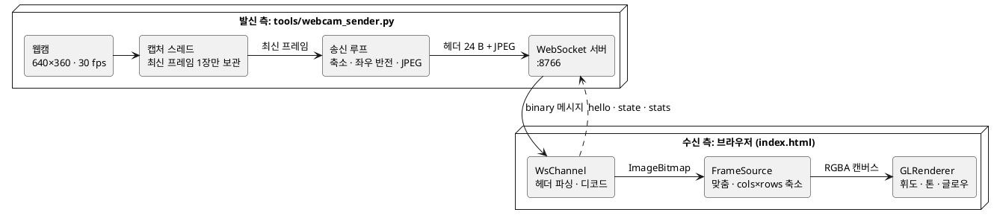
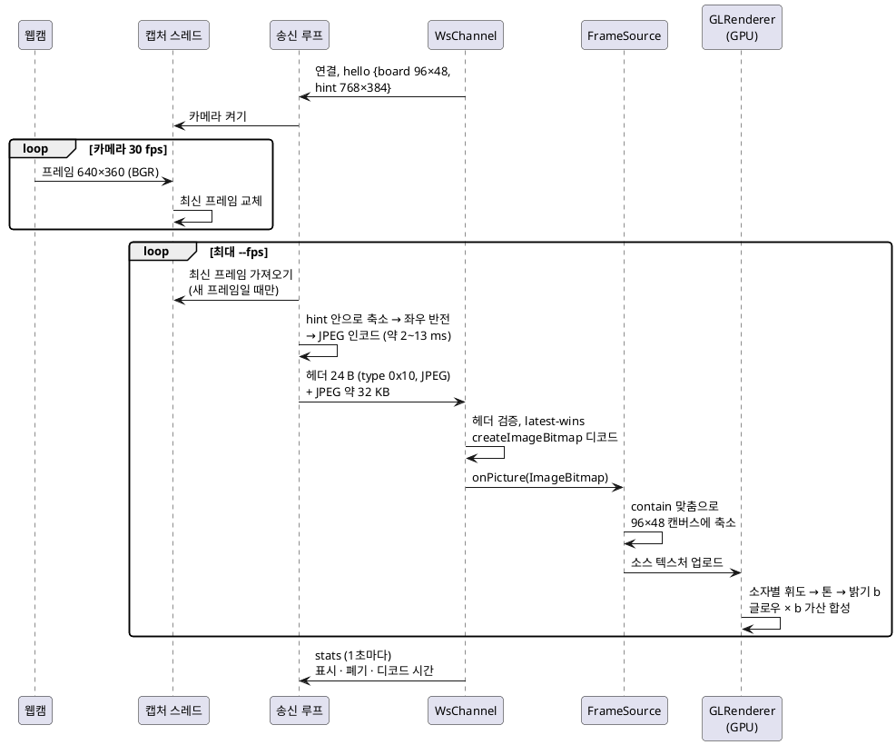

# 웹캠 테스트베드

- 작성일: 2026-11-17
- 관련 문서: [외부 소스 입력 인터페이스 사양](source-interface.md), [설계 문서](design.md)
- 도구: `tools/webcam_sender.py`

## 1. 목적

노트북 웹캠 영상을 **외부 프로그램이 WebSocket으로 보내고**, LED Board Simulator가 이를 받아 그레이스케일 LED로 표시하는 과정을 끝에서 끝까지 시험한다.

시뮬레이터에도 "카메라" 소스가 있지만, 그것은 브라우저가 직접 카메라를 여는 방식이라 외부 연동 경로를 거치지 않는다. 이 테스트베드는 실제 외부 장비·프로그램이 영상을 보내는 상황을 웹캠으로 재현한다.

| 항목 | 내장 카메라 소스 | 웹캠 테스트베드 |
|---|---|---|
| 카메라를 여는 쪽 | 브라우저 (`getUserMedia`) | 발신 프로그램 (Python + OpenCV) |
| 전송 경로 | 없음. 같은 페이지 안 | WebSocket, `ledboard.v1` IMAGE 메시지 |
| 검증 대상 | 표시 파이프라인 | 수신 규격 + 표시 파이프라인 + 흐름 제어 |
| 다른 PC의 카메라 | 불가 | 가능 (`--host 0.0.0.0`) |

## 2. 구성



## 3. 실행

```bash
pip install -r tools/requirements.txt
python tools/webcam_sender.py
```

```text
ws://127.0.0.1:8766/ 대기 중 (camera 0, jpeg). 시뮬레이터가 접속하면 카메라를 켬
```

브라우저 주소창에 시뮬레이터의 **전체 주소**를 넣는다. 또는 소스를 **외부 스트림 · WebSocket**으로 고르고 `ws://127.0.0.1:8766/`을 넣은 뒤 [연결]을 누른다.

```text
# 파일로 열 때 (경로는 저장소 위치에 맞게)
file:///D:/workspace/_Lab/LEDBoard/index.html?ws=ws://127.0.0.1:8766/

# 로컬 서버로 열 때 (저장소 폴더에서 python -m http.server 8000)
http://localhost:8000/index.html?ws=ws://127.0.0.1:8766/
```

`index.html?ws=...`만 넣으면 브라우저가 `index.html`을 도메인 이름으로 해석해 `DNS_PROBE_FINISHED_NXDOMAIN` 오류가 난다.

카메라는 시뮬레이터가 접속해 있는 동안에만 켜진다. 연결이 모두 끊기면 바로 꺼진다(`[camera] off`).

### 3.1 옵션

| 옵션 | 기본값 | 설명 |
|---|---|---|
| `--camera N` | 0 | 카메라 번호. 가상 카메라가 있으면 실제 카메라가 1번일 수 있음 |
| `--video 파일` | — | 카메라 대신 영상 파일을 반복 재생 |
| `--format` | `jpeg` | `jpeg` = IMAGE(JPEG). `gray8` = RAW 흑백 무압축 |
| `--quality` | 80 | JPEG 품질 |
| `--fps` | 30 | 최대 송신 fps |
| `--width`, `--height` | 시뮬레이터 hint | 송신 최대 크기. 지정하지 않으면 `hello`의 hint를 따름 |
| `--cap-width`, `--cap-height` | 640, 360 | 카메라에 요청하는 캡처 해상도 |
| `--backend` | `dshow` | Windows 캡처 백엔드. `msmf`, `auto` 선택 가능 |
| `--no-mirror` | — | 좌우 반전 끄기 |
| `--host` | 127.0.0.1 | 다른 PC에서 받으려면 `0.0.0.0` |
| `--port` | 8766 | 대기 포트 |

### 3.2 다른 PC에서 받기

웹캠이 있는 PC에서 `--host 0.0.0.0`으로 실행하고, 시뮬레이터 PC에서 `ws://<웹캠 PC IP>:8766/`으로 접속한다. Windows 방화벽이 처음 실행할 때 Python의 네트워크 접근 허용 여부를 묻는다. 허용하지 않으면 접속되지 않는다.

## 4. 처리 과정



### 4.1 발신 측

1. **연결과 크기 결정:** 시뮬레이터가 접속하면 `hello`를 받는다. 보드가 96×48이면 hint는 그 8배인 768×384다. 시뮬레이터가 결국 96×48로 줄이므로 이보다 크게 보내도 화질은 나아지지 않는다. 보드 크기가 바뀌면 `state`를 받아 hint를 다시 계산한다.
2. **캡처:** 별도 스레드가 카메라에서 계속 읽고 **가장 최근 프레임 하나만** 보관한다. 송신이 느려도 오래된 프레임이 쌓이지 않으므로 지연이 늘지 않는다.
3. **변환:** 송신 루프가 `--fps` 간격으로 최신 프레임을 꺼낸다. 이미 보낸 프레임이면 건너뛴다. 원본 비율을 유지하며 hint 안으로 축소하고(640×360은 이미 768×384 안이라 그대로), 좌우를 반전한다(거울처럼 보이게). 그다음 JPEG로 압축한다.
4. **전송:** 사양 5.2절의 24 byte 헤더(`magic "LB"`, `type 0x10 IMAGE`, `format 1 JPEG`, `seq`, `timestamp`, 크기)에 JPEG 바이트를 붙여 binary 메시지 하나로 보낸다.
5. **통계 출력:** 2초마다 카메라 fps, 송신 fps, 프레임 크기, 대역폭, 인코드 시간을 출력한다. 시뮬레이터가 보낸 `stats`(표시·폐기·디코드 시간)도 같은 줄에 붙인다.

### 4.2 수신 측

6. **수신과 검증:** `WsChannel`이 `ArrayBuffer`를 받아 크기 제한(16 MiB), magic, version, type, format을 확인한다. 틀리면 `error`를 회신하고 버린다.
7. **디코드:** `createImageBitmap(new Blob([payload], {type: 'image/jpeg'}))`로 디코드한다. 브라우저의 이미지 디코더를 쓰므로 메인 스레드 부담이 작다. 디코드 중에 새 메시지가 오면 대기 메시지는 가장 최근 것 하나만 남긴다(latest-wins).
8. **소스 교체:** 디코드 결과를 `FrameSource`에 넘기고, 이전 `ImageBitmap`은 즉시 해제(`close()`)한다. 화면 주기 안에 프레임이 또 바뀌면 이전 프레임은 표시되지 못하고 `dropped`로 센다.
9. **LED 해상도로 축소:** 다음 화면 주기(`requestAnimationFrame`)에 `FrameSource`가 `cols × rows` 캔버스를 검게 지우고, 맞춤 방식에 따라 이미지를 그린다. 640×360을 96×48 보드에 contain으로 맞추면 배율은 `min(96/640, 48/360) = 0.133`이라 85×48 영역이 되고, 좌우에 약 5열씩 빈 곳이 생긴다. 축소 필터는 `imageSmoothingQuality = 'high'`다.
10. **GPU 업로드:** 96×48 캔버스를 RGBA8 텍스처로 올린다. 소자 하나가 텍셀 하나다.
11. **소자 밝기 계산:** 버텍스 셰이더가 인스턴스(소자)마다 텍셀을 읽어 휘도(`0.2126 R + 0.7152 G + 0.0722 B`)를 구한다. 그다음 반전, 대비·밝기, 계조 양자화, 감마를 거쳐 밝기 b를 정한다. **컬러 웹캠 영상이 그레이스케일 LED가 되는 지점이 여기다.**
12. **글로우 합성:** 프래그먼트 셰이더가 공유 글로우 이미지에 b를 곱하고 LED 색을 입혀 가산 합성한다. 밝은 소자일수록 헤일로가 넓게 보인다([설계 문서](design.md) 3절).
13. **통계 회신:** 실제로 그린 프레임은 `displayed`로 센다. 1초마다 `stats`를 발신 측에 보낸다.

## 5. 측정 결과

2026-11-17, 이 노트북(LG Camera)과 헤드리스 Chrome(SwiftShader 소프트웨어 렌더링), 96×48 보드에서 측정했다.

| 항목 | JPEG (기본) | GRAY8 |
|---|---|---|
| 캡처 | 640×360, 21~30 fps | 640×360, 12~28 fps |
| 송신 크기 | 640×360 | 640×360 |
| 프레임당 크기 | 약 32 KB | 230.4 KB |
| 대역폭 | 3~4.4 Mbps | 9~25 Mbps |
| 발신 측 처리 시간 (축소 + 인코드) | 2~13 ms | 약 5 ms |
| 시뮬레이터 디코드 | 6~10 ms | 약 3 ms |
| 송신 fps | 12~17 | 5~14 |

- 송신 fps가 카메라보다 낮고 폐기가 늘어난 것은 헤드리스 Chrome이 소프트웨어 렌더링으로 초당 3~6 프레임만 그렸기 때문이다. 수신 측이 느려지면 발신 측도 송신 버퍼가 차서 함께 느려진다.
- 실제 GPU가 있는 브라우저 창에서의 fps와 지연은 측정하지 않았다.
- 같은 크기에서 JPEG가 GRAY8보다 약 7배 작다. LAN이 아니라면 JPEG를 쓴다.

## 6. 문제 해결

| 증상 | 원인 | 조치 |
|---|---|---|
| 카메라 fps가 10 정도 | 이 카메라는 DSHOW 백엔드에서 1280×720을 무압축(YUY2)으로만 보내 10 fps로 제한됨 | 기본값 640×360 사용(30 fps 확인). 고해상도가 필요하면 `--backend msmf --cap-width 1280 --cap-height 720`(30 fps 확인) |
| `카메라/영상을 열 수 없음` | 다른 앱이 카메라 사용 중이거나 번호가 다름 | 화상회의 앱 등을 종료. `--camera 1`로 변경. 가상 카메라(예: Mirametrix Virtual Camera)가 0번을 차지할 수 있음 |
| 출력을 파일로 돌리면 바로 종료됨 | 한국어 Windows에서 리다이렉트 시 cp949 인코딩으로 출력 | 도구에서 출력 오류를 무시하도록 처리함. 로그를 UTF-8로 남기려면 `python -X utf8 tools/webcam_sender.py > log.txt` |
| 브라우저에 `DNS_PROBE_FINISHED_NXDOMAIN` | 주소창에 `index.html?ws=...`만 입력해 `index.html`이 도메인으로 해석됨 | `file:///.../index.html?ws=...` 또는 `http://localhost:8000/index.html?ws=...`처럼 전체 주소 입력 (3절) |
| 시뮬레이터가 "재연결 n초 후" 반복 | 발신 도구가 꺼져 있거나 포트·주소가 다름 | 발신 도구의 대기 주소와 시뮬레이터 URL 비교. 다른 PC면 `--host 0.0.0.0`과 방화벽 확인 |
| 시뮬레이터 `폐기` 수가 빠르게 증가 | 화면 그리는 속도보다 빨리 도착 | 정상 동작(latest-wins). 줄이려면 `--fps`를 화면 fps 이하로 |
| 화면이 너무 어둡거나 밝음 | 카메라 자동 노출, 조명 | 시뮬레이터의 밝기·대비·감마로 보정 |
