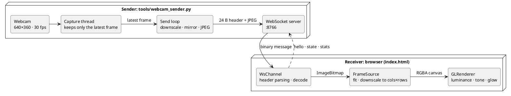
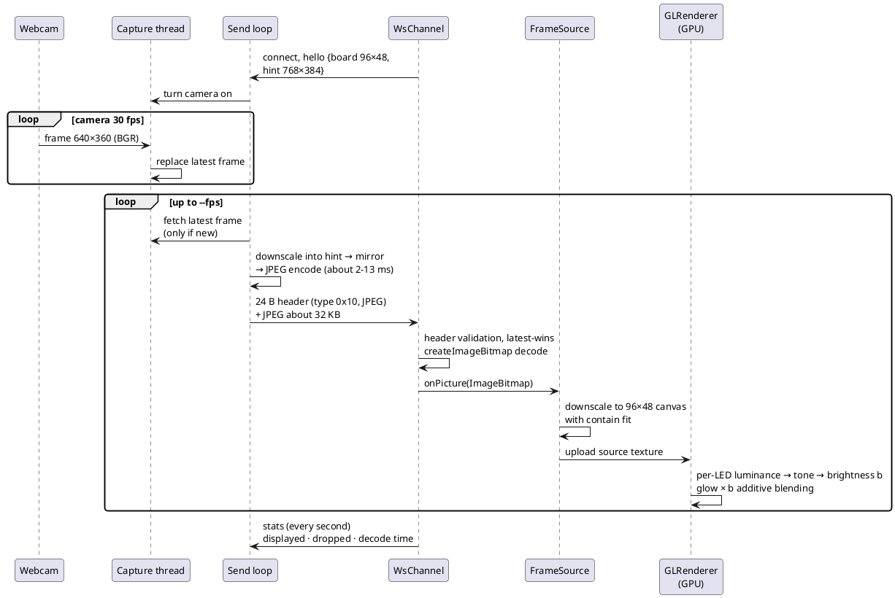

# Webcam Test Bed

**English** | [한국어](webcam-testbed.ko.md)

- Date: 2026-11-17
- Related documents: [External Source Input Interface Specification](source-interface.md), [Design Document](design.md)
- Tool: `tools/webcam_sender.py`

## 1. Purpose

Tests the end-to-end path in which **an external program sends a laptop webcam stream over WebSocket** and LED Board Simulator receives it and displays it as grayscale LEDs.

The simulator also has a "Camera" source, but there the browser opens the camera directly, so it does not go through the external integration path. This test bed uses a webcam to reproduce the situation where real external equipment or a program sends video.

| Item | Built-in camera source | Webcam test bed |
|---|---|---|
| Who opens the camera | Browser (`getUserMedia`) | Sender program (Python + OpenCV) |
| Transport path | None. Within the same page | WebSocket, `ledboard.v1` IMAGE messages |
| What is verified | Display pipeline | Receive spec + display pipeline + flow control |
| Camera on another PC | Not possible | Possible (`--host 0.0.0.0`) |

## 2. Architecture



## 3. Running

```bash
pip install -r tools/requirements.txt
python tools/webcam_sender.py
```

```text
ws://127.0.0.1:8766/ 대기 중 (camera 0, jpeg). 시뮬레이터가 접속하면 카메라를 켬
```

(Glossed: "Waiting on ws://127.0.0.1:8766/ (camera 0, jpeg). The camera turns on when the simulator connects.")

Enter the simulator's **full address** in the browser address bar. Alternatively, select **External stream · WebSocket** as the source, enter `ws://127.0.0.1:8766/`, and press [Connect].

```text
# When opening as a file (adjust the path to your repository location)
file:///D:/workspace/_Lab/LEDBoard/index.html?ws=ws://127.0.0.1:8766/

# When opening via a local server (python -m http.server 8000 in the repository folder)
http://localhost:8000/index.html?ws=ws://127.0.0.1:8766/
```

If you enter only `index.html?ws=...`, the browser interprets `index.html` as a domain name and you get a `DNS_PROBE_FINISHED_NXDOMAIN` error.

The camera is on only while the simulator is connected. When all connections close, it turns off immediately (`[camera] off`).

### 3.1 Options

| Option | Default | Description |
|---|---|---|
| `--camera N` | 0 | Camera index. If a virtual camera exists, the real camera may be index 1 |
| `--video FILE` | — | Loops a video file instead of the camera |
| `--format` | `jpeg` | `jpeg` = IMAGE (JPEG). `gray8` = RAW uncompressed grayscale |
| `--quality` | 80 | JPEG quality |
| `--fps` | 30 | Maximum send fps |
| `--width`, `--height` | Simulator hint | Maximum send size. If not specified, follows the hint in `hello` |
| `--cap-width`, `--cap-height` | 640, 360 | Capture resolution requested from the camera |
| `--backend` | `dshow` | Windows capture backend. `msmf` and `auto` also available |
| `--no-mirror` | — | Turns off mirroring |
| `--host` | 127.0.0.1 | `0.0.0.0` to receive on another PC |
| `--port` | 8766 | Listening port |

### 3.2 Receiving on Another PC

Run with `--host 0.0.0.0` on the PC with the webcam, and connect from the simulator PC to `ws://<webcam PC IP>:8766/`. On the first run, Windows Firewall asks whether to allow network access for Python. If you do not allow it, the connection fails.

## 4. Processing Flow



### 4.1 Sender

1. **Connection and size decision:** When the simulator connects, the sender receives `hello`. If the board is 96×48, the hint is 8 times that, 768×384. Since the simulator ends up downscaling to 96×48 anyway, sending anything larger does not improve image quality. When the board size changes, the sender receives `state` and recalculates the hint.
2. **Capture:** A separate thread reads continuously from the camera and keeps **only the most recent frame**. Even if sending is slow, old frames do not pile up, so latency does not grow.
3. **Conversion:** The send loop takes the latest frame at `--fps` intervals. If the frame has already been sent, it is skipped. The frame is downscaled into the hint while keeping the original aspect ratio (640×360 already fits within 768×384, so it stays as is), and mirrored horizontally (so it looks like a mirror). Then it is compressed to JPEG.
4. **Transmission:** The JPEG bytes are appended to the 24-byte header from section 5.2 of the spec (`magic "LB"`, `type 0x10 IMAGE`, `format 1 JPEG`, `seq`, `timestamp`, size) and sent as a single binary message.
5. **Statistics output:** Every 2 seconds, the sender prints the camera fps, send fps, frame size, bandwidth, and encode time. The `stats` sent by the simulator (displayed, dropped, decode time) are appended to the same line.

### 4.2 Receiver

6. **Reception and validation:** `WsChannel` receives an `ArrayBuffer` and checks the size limit (16 MiB), magic, version, type, and format. If anything is wrong, it replies with `error` and discards the message.
7. **Decode:** Decodes with `createImageBitmap(new Blob([payload], {type: 'image/jpeg'}))`. Because it uses the browser's image decoder, the load on the main thread is small. If a new message arrives during decoding, only the most recent pending message is kept (latest-wins).
8. **Source replacement:** The decoded result is handed to `FrameSource`, and the previous `ImageBitmap` is released immediately (`close()`). If the frame changes again within one display cycle, the previous frame is never displayed and is counted as `dropped`.
9. **Downscale to LED resolution:** On the next display cycle (`requestAnimationFrame`), `FrameSource` clears a `cols × rows` canvas to black and draws the image according to the fit mode. Fitting 640×360 onto a 96×48 board with contain gives a scale of `min(96/640, 48/360) = 0.133`, resulting in an 85×48 area with about 5 empty columns on each side. The downscaling filter is `imageSmoothingQuality = 'high'`.
10. **GPU upload:** The 96×48 canvas is uploaded as an RGBA8 texture. One LED is one texel.
11. **LED brightness calculation:** The vertex shader reads the texel for each instance (LED) and computes luminance (`0.2126 R + 0.7152 G + 0.0722 B`). It then applies invert, contrast/brightness, gray-level quantization, and gamma to determine brightness b. **This is the point where the color webcam video becomes grayscale LEDs.**
12. **Glow blending:** The fragment shader multiplies the shared glow image by b, applies the LED color, and blends additively. The brighter the LED, the wider its halo appears ([Design Document](design.md) section 3).
13. **Statistics reply:** Frames that are actually drawn are counted as `displayed`. Every second, `stats` is sent to the sender.

## 5. Measurement Results

Measured on 2026-11-17 with this laptop (LG Camera), headless Chrome (SwiftShader software rendering), and a 96×48 board.

| Item | JPEG (default) | GRAY8 |
|---|---|---|
| Capture | 640×360, 21–30 fps | 640×360, 12–28 fps |
| Send size | 640×360 | 640×360 |
| Size per frame | About 32 KB | 230.4 KB |
| Bandwidth | 3–4.4 Mbps | 9–25 Mbps |
| Sender processing time (downscale + encode) | 2–13 ms | About 5 ms |
| Simulator decode | 6–10 ms | About 3 ms |
| Send fps | 12–17 | 5–14 |

- The send fps was lower than the camera's and drops increased because headless Chrome drew only 3–6 frames per second with software rendering. When the receiver slows down, the sender's send buffer fills up and the sender slows down as well.
- fps and latency in a browser window with a real GPU were not measured.
- At the same size, JPEG is about 7 times smaller than GRAY8. Use JPEG unless you are on a LAN.

## 6. Troubleshooting

| Symptom | Cause | Action |
|---|---|---|
| Camera fps around 10 | This camera sends 1280×720 only uncompressed (YUY2) on the DSHOW backend, limited to 10 fps | Use the default 640×360 (30 fps confirmed). If high resolution is needed, `--backend msmf --cap-width 1280 --cap-height 720` (30 fps confirmed) |
| `카메라/영상을 열 수 없음` ("cannot open camera/video") | Another app is using the camera, or the index is different | Close video conferencing apps, etc. Change to `--camera 1`. A virtual camera (e.g. Mirametrix Virtual Camera) may occupy index 0 |
| Exits immediately when output is redirected to a file | On Korean Windows, output is encoded as cp949 when redirected | The tool now ignores output errors. To keep the log in UTF-8, `python -X utf8 tools/webcam_sender.py > log.txt` |
| `DNS_PROBE_FINISHED_NXDOMAIN` in the browser | Only `index.html?ws=...` entered in the address bar, so `index.html` is interpreted as a domain | Enter the full address, such as `file:///.../index.html?ws=...` or `http://localhost:8000/index.html?ws=...` (section 3) |
| Simulator repeats "Reconnecting in n s" | Sender tool is not running, or the port/address differs | Compare the sender tool's listening address with the simulator URL. If on another PC, check `--host 0.0.0.0` and the firewall |
| Simulator `dropped` count rises quickly | Frames arrive faster than the screen is drawn | Normal behavior (latest-wins). To reduce it, set `--fps` at or below the screen fps |
| Image too dark or too bright | Camera auto exposure, lighting | Compensate with the simulator's Brightness, Contrast, and Gamma |
